<!-- GENERADO con `make guiones` desde public/mapas/guiones/el-aliento-helado-1.json. NO EDITAR: los cambios se hacen en el JSON. -->
# El Aliento Helado · Capítulo I: Los muelles callados

> **Fuente única:** `public/mapas/guiones/el-aliento-helado-1.json` (la app la carga tal cual). Esquema y flujo de trabajo: `guiones/LEEME.md`.
> Mapa: `public/mapas/imagenes/casa-del-pescador.webp` · Validar: `make validar-guion CAMPANA=el-aliento-helado CAPITULO=1`

**Objetivo:** Descubrir qué le pasó a Tormund, seguir sus pistas de la casa al almacén, quitarle al trovador contrabandista el fuego y la barca, y salir por mar, entre la niebla, hacia el faro.

**Cómo es el mapa:** Entrada por el sendero de playa del sur, entre la laguna helada (oeste) y el agua (este); un mástil viejo tirado en la arena. A la izquierda del sendero, arbustos nevados junto a un arcón con cerrojo y un embarcadero pequeño sobre la laguna. En el centro, la playa abierta. Al noroeste, el almacén sobre una lengua de arena unida a la playa: se entra por la gran puerta del costado este, subiendo una rampa de tablas desde la arena; en la pared sur se amontonan redes (desde ahí se mira por las rendijas); al oeste, un cobertizo abierto con barriles; detrás, al norte, el muelle de la grúa, con una puerta trasera atrancada por dentro, al que solo se llega rodeando por la orilla oeste. La barca está amarrada en la orilla oeste de la lengua de arena, junto al extremo norte de la pasarela ancha del oeste. Al este, un canal de agua azul con espuma; un puente recto de tablas lo cruza hasta el rellano de madera de la casa de Tormund. Desde el rellano, una escalera curva sube por fuera al acantilado. Casa: sala con chimenea en la pared norte (encimera con cuencos debajo) y mesa redonda con papeles al noreste; despensa al suroeste; dormitorio al sur con la cama de manta azul. Desde lo alto de la escalera curva (acantilado) se ve, por encima del canal, el muelle de la grúa detrás del almacén; desde dentro de la casa, no.

**Escena inicial:** `llegada` · **Escenas:** 39 · **Combates:** 5 escenas de combate (cada camino pasa por 4)

## Marcas (estado del grupo)

Una marca existe si se visitó la escena con ese id o si una escena visitada la pone en `marca`. Las opciones se ven solo si tienen todas sus `si` y ninguna de sus `salvo`.

| Marca | La ponen | Se muestra al máster |
|---|---|---|
| `visto-almacen` | `almacen-cerrado`, `almacen-tras-lobos`, `almacen-puerta`, `almacen-puerta-esperados` | — |
| `ruido` | `candado-golpes`, `registro-en-vano`, `chimenea`, `brasas-fallidas` | En el almacén están avisados: no habrá sorpresa |
| `visto-barca` | `barca-helada`, `barca-tras-lobos`, `barca-con-llave` | — |
| `rastro` | `rastro` | — |
| `llave` | `llave-silencio`, `llave-tras-destrozo`, `pagina-de-sangre` | Tienen la llave del almacén |
| `chimenea` | `chimenea`, `brasas-fallidas` | Ya descansaron junto a la chimenea |
| `intento-brasas` | `brasas-fallidas` | — |
| `trasera-abierta` | `vigilar` | La puerta trasera del almacén (muelle de la grúa) está sin atrancar |
| `sabe-niebla` | `almacen-comida` | Saben que el trovador viene con la niebla |
| `barca-suelta` | `barca-deshielo`, `barca-libre` | El farol de la barca está encendido: pueden cruzar la niebla |
| `aceite` | `aceite` | — |

## Personajes

- **Tormund** (víctima): Viejo pescador de la costa norte que dio la alarma y desapareció hace tres días *Cómo interpretarlo:* Solo aparece a través de su cuaderno: el máster lee sus notas con letra apresurada y tono de miedo contenido *Qué sabe:* Su cuaderno cuenta que una sombra enorme voló hacia el faro, que unos encapuchados le alquilaron el almacén con monedas heladas y, en clave, que escondió la llave del almacén en la chimenea.
- **El alcalde** (neutral): Alcalde del pueblo que contrata a los héroes con una bolsa de monedas *Cómo interpretarlo:* Habla con prisa y autoridad, frotándose las manos por el frío *Qué sabe:* Encarga seguir el rastro del frío hasta quien lo manda y envía a los héroes a la casa de Tormund.
- **Vórtiga** (villano): Gárgola de roca agrietada con alas y cuernos que encadenó a la dragona Velgrima y manda la Hermandad del Hueso *Cómo interpretarlo:* Aquí solo se la nombra: el sátiro la llama con reverencia «la señora de piedra» *Qué sabe:* Prometió al sátiro una corona de escarcha cuando la costa sea suya; su gárgola aparece grabada en la moneda helada.
- **El trovador** (enemigo): Sátiro flautista de la Hermandad del Hueso, contrabandista del aceite del faro *Cómo interpretarlo:* Canturrea todo lo que dice, burlón y presumido; se cree ya dueño de la cala *Qué sabe:* Desde que Tormund desapareció usa su barca: cada noche, al caer la niebla, carga el aceite del almacén, enciende el farol de proa con las brasas del diablillo (el único fuego que la niebla helada no apaga) y lo lleva al faro para la señora de piedra.
- **El diablillo** (enemigo): Diablillo del Fogón al servicio de la Hermandad del Hueso: guarda en el almacén el brasero de fuego de diablo, el único que la niebla helada no apaga *Cómo interpretarlo:* Risita aguda, glotón y muerto de hambre; habla con la boca llena y se cree muy listo *Qué sabe:* Cuida el fuego para el músico de las pezuñas (el trovador), que viene cada noche al caer la niebla, carga el aceite en la barca de Tormund y enciende el farol con sus brasas. Lo cuenta si le dan comida.
- **La rana** (enemigo): Rana Ballestera, guardia de la Hermandad del Hueso que vigila los toneles de aceite del almacén *Cómo interpretarlo:* No habla: dormita sobre las cajas y dispara antes de preguntar; croa cuando se enfada *Qué sabe:* Nada que cuente: solo obedece al trovador.

## Diagrama

Flecha continua = opción (con su condición); discontinua = `sigue` (sin elección). Rojo = combate, morado = enigma, verde = fin.

```mermaid
flowchart TD
  llegada["La cala de Tormund"]
  arbustos["Ojos entre los arbustos"]
  puente_casa["Aullidos a la espalda"]
  almacen_cerrado["El candado del pez"]
  candado_golpes["Golpes en la noche"]
  espiar["Por las rendijas"]
  rodear_almacen["La puerta de atrás"]
  hacia_casa["La manada"]
  barca_helada["La barca y la niebla"]
  romper_hielo["Una llama que no prende"]
  lobos(["⚔ Los lobos espinosos"])
  almacen_tras_lobos["El candado del pez"]
  barca_tras_lobos["La barca y la niebla"]
  rastro["El gorro de Tormund"]
  casa(["⚔ La casa de piedra"])
  cuaderno{{"🧩 El cuaderno de Tormund"}}
  llave_silencio["La llave en la ceniza"]
  registro_en_vano["Registro en vano"]
  llave_tras_destrozo["La llave en la ceniza"]
  ofrenda_sangre["La ofrenda de sangre"]
  pagina_de_sangre["La página se abre"]
  barca_con_llave["La barca sin luz"]
  chimenea["Calor prestado"]
  brasas_fallidas["Brasas que se apagan"]
  vigilar["Ojos desde el acantilado"]
  almacen_puerta["El candado cede"]
  almacen_frente["De frente"]
  almacen_grua["Por la puerta de atrás"]
  almacen_grua_esperados["Os estaban esperando"]
  almacen_comida["Pan para el diablillo"]
  almacen_combate(["⚔ Ballesta y brasas"])
  almacen_registro["Toneles con un hueso"]
  barca_deshielo(["⚔ El farol y el trovador"])
  emboscada(["⚔ Emboscada en la niebla"])
  barca_libre["Luz en la niebla"]
  zurron["El zurrón del trovador"]
  aceite["El aceite al mar"]
  fin((" Rumbo al faro "))
  almacen_puerta_esperados["Os están esperando"]
  llegada -->|"Miramos qué se mueve en los arbustos"| arbustos
  llegada -->|"Cruzamos el puente hacia la casa"| puente_casa
  llegada -->|"Subimos al almacén de la lucecita roja"| almacen_cerrado
  llegada -->|"Vamos a mirar la barca"| barca_helada
  arbustos -.-> lobos
  puente_casa -.-> lobos
  almacen_cerrado -->|"Forzamos el candado a golpes"| candado_golpes
  almacen_cerrado -->|"Espiamos por las rendijas"| espiar
  almacen_cerrado -->|"Vamos a buscar la llave a casa de Tormun"| hacia_casa
  almacen_cerrado -->|"Vamos a ver la barca [salvo visto-barca]"| barca_helada
  candado_golpes -.-> lobos
  espiar -->|"Vamos a buscar la llave a casa de Tormun"| hacia_casa
  espiar -->|"Rodeamos el almacén hasta la puerta tras"| rodear_almacen
  espiar -->|"Vamos a ver la barca [salvo visto-barca]"| barca_helada
  rodear_almacen -.-> lobos
  hacia_casa -.-> lobos
  barca_helada -->|"Seguimos las huellas hasta el almacén [salvo visto-almacen]"| almacen_cerrado
  barca_helada -->|"Intentamos encender el farol con nuestra"| romper_hielo
  barca_helada -->|"Vamos a la casa de Tormund"| hacia_casa
  romper_hielo -.-> lobos
  lobos -->|"Cruzamos el puente hacia la casa de Torm"| casa
  lobos -->|"Subimos a ver el almacén [salvo visto-almacen]"| almacen_tras_lobos
  lobos -->|"Vamos a ver la barca [salvo visto-barca]"| barca_tras_lobos
  lobos -->|"Seguimos el rastro de los lobos hasta lo [salvo rastro]"| rastro
  almacen_tras_lobos -->|"Vamos a buscar la llave a casa de Tormun"| casa
  almacen_tras_lobos -->|"Vamos a ver la barca [salvo visto-barca]"| barca_tras_lobos
  almacen_tras_lobos -->|"Seguimos el rastro de los lobos hasta lo [salvo rastro]"| rastro
  barca_tras_lobos -->|"Vamos a la casa de Tormund"| casa
  barca_tras_lobos -->|"Seguimos las huellas hasta el almacén [salvo visto-almacen]"| almacen_tras_lobos
  barca_tras_lobos -->|"Seguimos el rastro de los lobos hasta lo [salvo rastro]"| rastro
  rastro -->|"Cruzamos el puente hacia la casa de Torm [salvo llave]"| casa
  rastro -->|"Subimos a ver el almacén [salvo visto-almacen o llave]"| almacen_tras_lobos
  rastro -->|"Vamos a ver la barca [salvo visto-barca o llave]"| barca_tras_lobos
  rastro -->|"Vamos al almacén a abrir el candado [si llave; salvo ruido]"| almacen_puerta
  rastro -->|"Vamos al almacén a abrir el candado [si ruido y llave]"| almacen_puerta_esperados
  rastro -->|"Vamos por la orilla a la puerta trasera [si trasera-abierta y llave; salvo ruido]"| almacen_grua
  rastro -->|"Vamos por la orilla a la puerta trasera [si trasera-abierta y ruido y llave]"| almacen_grua_esperados
  rastro -->|"Vamos a ver la barca [si llave; salvo visto-barca]"| barca_con_llave
  rastro -->|"Llevamos brasas de la chimenea a la barc [si visto-barca y llave; salvo intento-brasas]"| brasas_fallidas
  rastro -->|"Encendemos la chimenea y descansamos [si llave; salvo chimenea]"| chimenea
  rastro -->|"Vigilamos el almacén desde lo alto del a [si llave; salvo trasera-abierta]"| vigilar
  rastro -->|"Seguimos el rastro de los lobos hasta lo [si llave; salvo rastro]"| rastro
  casa -->|"Intentamos descifrar la última página"| cuaderno
  casa -->|"Lo dejamos y registramos la casa a fondo"| registro_en_vano
  cuaderno -->|"Sí: la llave está en la chimenea [salvo registro-en-vano]"| llave_silencio
  cuaderno -->|"Sí: la llave está en la chimenea [si registro-en-vano]"| llave_tras_destrozo
  cuaderno -->|"No: solo queda una ofrenda de sangre"| ofrenda_sangre
  llave_silencio -->|"Vamos al almacén a abrir el candado [salvo ruido]"| almacen_puerta
  llave_silencio -->|"Vamos al almacén a abrir el candado [si ruido]"| almacen_puerta_esperados
  llave_silencio -->|"Vamos por la orilla a la puerta trasera [si trasera-abierta; salvo ruido]"| almacen_grua
  llave_silencio -->|"Vamos por la orilla a la puerta trasera [si trasera-abierta y ruido]"| almacen_grua_esperados
  llave_silencio -->|"Vamos a ver la barca [salvo visto-barca]"| barca_con_llave
  llave_silencio -->|"Llevamos brasas de la chimenea a la barc [si visto-barca; salvo intento-brasas]"| brasas_fallidas
  llave_silencio -->|"Encendemos la chimenea y descansamos [salvo chimenea]"| chimenea
  llave_silencio -->|"Vigilamos el almacén desde lo alto del a [salvo trasera-abierta]"| vigilar
  llave_silencio -->|"Seguimos el rastro de los lobos hasta lo [salvo rastro]"| rastro
  registro_en_vano -.-> cuaderno
  llave_tras_destrozo -->|"Vamos al almacén a abrir el candado [salvo ruido]"| almacen_puerta
  llave_tras_destrozo -->|"Vamos al almacén a abrir el candado [si ruido]"| almacen_puerta_esperados
  llave_tras_destrozo -->|"Vamos por la orilla a la puerta trasera [si trasera-abierta; salvo ruido]"| almacen_grua
  llave_tras_destrozo -->|"Vamos por la orilla a la puerta trasera [si trasera-abierta y ruido]"| almacen_grua_esperados
  llave_tras_destrozo -->|"Vamos a ver la barca [salvo visto-barca]"| barca_con_llave
  llave_tras_destrozo -->|"Llevamos brasas de la chimenea a la barc [si visto-barca; salvo intento-brasas]"| brasas_fallidas
  llave_tras_destrozo -->|"Encendemos la chimenea y descansamos [salvo chimenea]"| chimenea
  llave_tras_destrozo -->|"Vigilamos el almacén desde lo alto del a [salvo trasera-abierta]"| vigilar
  llave_tras_destrozo -->|"Seguimos el rastro de los lobos hasta lo [salvo rastro]"| rastro
  ofrenda_sangre -.-> pagina_de_sangre
  pagina_de_sangre -->|"Vamos al almacén a abrir el candado [salvo ruido]"| almacen_puerta
  pagina_de_sangre -->|"Vamos al almacén a abrir el candado [si ruido]"| almacen_puerta_esperados
  pagina_de_sangre -->|"Vamos por la orilla a la puerta trasera [si trasera-abierta; salvo ruido]"| almacen_grua
  pagina_de_sangre -->|"Vamos por la orilla a la puerta trasera [si trasera-abierta y ruido]"| almacen_grua_esperados
  pagina_de_sangre -->|"Vamos a ver la barca [salvo visto-barca]"| barca_con_llave
  pagina_de_sangre -->|"Llevamos brasas de la chimenea a la barc [si visto-barca; salvo intento-brasas]"| brasas_fallidas
  pagina_de_sangre -->|"Encendemos la chimenea y descansamos [salvo chimenea]"| chimenea
  pagina_de_sangre -->|"Vigilamos el almacén desde lo alto del a [salvo trasera-abierta]"| vigilar
  pagina_de_sangre -->|"Seguimos el rastro de los lobos hasta lo [salvo rastro]"| rastro
  barca_con_llave -->|"Vamos al almacén a por ese fuego [salvo ruido]"| almacen_puerta
  barca_con_llave -->|"Vamos al almacén a por ese fuego [si ruido]"| almacen_puerta_esperados
  barca_con_llave -->|"Volvemos a la casa a por brasas de la ch [salvo intento-brasas]"| brasas_fallidas
  barca_con_llave -->|"Vamos por la orilla a la puerta trasera [si trasera-abierta; salvo ruido]"| almacen_grua
  barca_con_llave -->|"Vamos por la orilla a la puerta trasera [si trasera-abierta y ruido]"| almacen_grua_esperados
  barca_con_llave -->|"Vamos a ver la barca [salvo visto-barca]"| barca_con_llave
  barca_con_llave -->|"Llevamos brasas de la chimenea a la barc [si visto-barca; salvo intento-brasas]"| brasas_fallidas
  barca_con_llave -->|"Encendemos la chimenea y descansamos [salvo chimenea]"| chimenea
  barca_con_llave -->|"Vigilamos el almacén desde lo alto del a [salvo trasera-abierta]"| vigilar
  barca_con_llave -->|"Seguimos el rastro de los lobos hasta lo [salvo rastro]"| rastro
  chimenea -->|"Vamos al almacén [salvo ruido]"| almacen_puerta
  chimenea -->|"Vamos al almacén [si ruido]"| almacen_puerta_esperados
  chimenea -->|"Vigilamos el almacén desde lo alto del a [salvo trasera-abierta]"| vigilar
  chimenea -->|"Llevamos brasas a la barca para encender [si visto-barca; salvo intento-brasas]"| brasas_fallidas
  chimenea -->|"Vamos por la orilla a la puerta trasera [si trasera-abierta; salvo ruido]"| almacen_grua
  chimenea -->|"Vamos por la orilla a la puerta trasera [si trasera-abierta y ruido]"| almacen_grua_esperados
  chimenea -->|"Vamos a ver la barca [salvo visto-barca]"| barca_con_llave
  chimenea -->|"Encendemos la chimenea y descansamos [salvo chimenea]"| chimenea
  chimenea -->|"Seguimos el rastro de los lobos hasta lo [salvo rastro]"| rastro
  brasas_fallidas -->|"Vamos al almacén a por ese fuego [salvo ruido]"| almacen_puerta
  brasas_fallidas -->|"Vamos al almacén a por ese fuego [si ruido]"| almacen_puerta_esperados
  brasas_fallidas -->|"Vigilamos el almacén desde lo alto del a [salvo trasera-abierta]"| vigilar
  brasas_fallidas -->|"Vamos por la orilla a la puerta trasera [si trasera-abierta; salvo ruido]"| almacen_grua
  brasas_fallidas -->|"Vamos por la orilla a la puerta trasera [si trasera-abierta y ruido]"| almacen_grua_esperados
  brasas_fallidas -->|"Vamos a ver la barca [salvo visto-barca]"| barca_con_llave
  brasas_fallidas -->|"Llevamos brasas de la chimenea a la barc [si visto-barca; salvo intento-brasas]"| brasas_fallidas
  brasas_fallidas -->|"Encendemos la chimenea y descansamos [salvo chimenea]"| chimenea
  brasas_fallidas -->|"Seguimos el rastro de los lobos hasta lo [salvo rastro]"| rastro
  vigilar -->|"Vamos a la puerta grande con la llave [salvo ruido]"| almacen_puerta
  vigilar -->|"Vamos a la puerta grande con la llave [si ruido]"| almacen_puerta_esperados
  vigilar -->|"Vamos por la orilla a la puerta trasera [si trasera-abierta; salvo ruido]"| almacen_grua
  vigilar -->|"Vamos por la orilla a la puerta trasera [si trasera-abierta y ruido]"| almacen_grua_esperados
  vigilar -->|"Vamos a ver la barca [salvo visto-barca]"| barca_con_llave
  vigilar -->|"Llevamos brasas de la chimenea a la barc [si visto-barca; salvo intento-brasas]"| brasas_fallidas
  vigilar -->|"Encendemos la chimenea y descansamos [salvo chimenea]"| chimenea
  vigilar -->|"Vigilamos el almacén desde lo alto del a [salvo trasera-abierta]"| vigilar
  vigilar -->|"Seguimos el rastro de los lobos hasta lo [salvo rastro]"| rastro
  almacen_puerta -->|"Entramos de frente por la puerta"| almacen_frente
  almacen_puerta -->|"Cerramos sin ruido y rodeamos hasta la p [si trasera-abierta; salvo ruido]"| almacen_grua
  almacen_puerta -->|"Nos dejamos ver y les ofrecemos comida"| almacen_comida
  almacen_frente -.-> almacen_combate
  almacen_grua -.-> almacen_combate
  almacen_grua_esperados -.-> almacen_combate
  almacen_comida -->|"Nos lanzamos a por la rana"| almacen_combate
  almacen_combate -->|"Bajamos el brasero a la barca ahora mism"| barca_deshielo
  almacen_combate -->|"Nos escondemos aquí y esperamos al trova"| emboscada
  almacen_combate -->|"Registramos el almacén antes de que lleg [salvo almacen-registro]"| almacen_registro
  almacen_registro -->|"Bajamos el brasero a la barca"| barca_deshielo
  almacen_registro -->|"Nos escondemos aquí y esperamos al trova"| emboscada
  barca_deshielo -->|"Volvemos a la taberna y zarpamos al alba"| fin
  barca_deshielo -->|"Registramos al sátiro antes de irnos [salvo zurron]"| zurron
  barca_deshielo -->|"Echamos al mar los toneles de aceite [salvo aceite]"| aceite
  emboscada -->|"Bajamos el brasero a la barca"| barca_libre
  emboscada -->|"Registramos al sátiro [salvo zurron]"| zurron
  emboscada -->|"Echamos al mar los toneles de aceite [salvo aceite]"| aceite
  barca_libre -->|"Volvemos a la taberna y zarpamos al alba"| fin
  barca_libre -->|"Registramos al sátiro antes de irnos [salvo zurron]"| zurron
  barca_libre -->|"Echamos al mar los toneles de aceite [salvo aceite]"| aceite
  zurron -->|"Volvemos a la taberna y zarpamos al alba [si barca-suelta]"| fin
  zurron -->|"Bajamos el brasero a la barca [salvo barca-suelta]"| barca_libre
  zurron -->|"Echamos al mar los toneles de aceite [salvo aceite]"| aceite
  aceite -->|"Volvemos a la taberna y zarpamos al alba [si barca-suelta]"| fin
  aceite -->|"Bajamos el brasero a la barca [salvo barca-suelta]"| barca_libre
  aceite -->|"Registramos al sátiro [salvo zurron]"| zurron
  almacen_puerta_esperados -->|"Entramos de frente por la puerta"| almacen_frente
  almacen_puerta_esperados -->|"Cerramos y rodeamos hasta la puerta tras [si trasera-abierta]"| almacen_grua_esperados
  almacen_puerta_esperados -->|"Le enseñamos comida al diablillo"| almacen_comida
  class lobos combate
  class casa combate
  class cuaderno enigma
  class almacen_combate combate
  class barca_deshielo combate
  class emboscada combate
  class fin fin
  classDef combate fill:#f8d7d7,stroke:#a33
  classDef enigma fill:#e6dcf5,stroke:#63a
  classDef fin fill:#d7f0d7,stroke:#393
```

## Opciones comunes

### `con-la-llave` — Con la llave en la mano, ¿qué hacéis?

| Opción | Va a | Condición | Nota para el máster |
|---|---|---|---|
| Vamos al almacén a abrir el candado | `almacen-puerta` | salvo `ruido` |  |
| Vamos al almacén a abrir el candado | `almacen-puerta-esperados` | si `ruido` | Los esperan: no hay sorpresa. |
| Vamos por la orilla a la puerta trasera | `almacen-grua` | si `trasera-abierta`; salvo `ruido` | Atacan por sorpresa. |
| Vamos por la orilla a la puerta trasera | `almacen-grua-esperados` | si `trasera-abierta` y `ruido` | Los esperan: no hay sorpresa. |
| Vamos a ver la barca | `barca-con-llave` | salvo `visto-barca` | No tiene candado: le falta luz para cruzar la niebla. Ven las huellas de pezuña del trovador. |
| Llevamos brasas de la chimenea a la barca | `brasas-fallidas` | si `visto-barca`; salvo `intento-brasas` | El fuego normal no aguanta esta niebla. |
| Encendemos la chimenea y descansamos | `chimenea` | salvo `chimenea` | +1 de vida cada uno, pero el humo los delata. |
| Vigilamos el almacén desde lo alto del acantilado | `vigilar` | salvo `trasera-abierta` | Desde la escalera curva de la casa se ve el muelle de detrás del almacén. |
| Seguimos el rastro de los lobos hasta los arbustos | `rastro` | salvo `rastro` | Encuentran una pista de quién se llevó a Tormund. |

## Escenas

### `llegada` — La cala de Tormund

*Escena* · Lugar: Sendero de la playa · Posición: x 56 %, y 92 %

Llegan desde: — (inicio)

**Narración** (leer en voz alta):
> Dejáis atrás el pueblo y bajáis por el sendero de arena que serpentea entre las rocas, con la nieve hasta las rodillas. Al caer la tarde se abre ante vosotros la cala de Tormund. A la derecha, al otro lado de un canal de agua azul que rompe en espuma, se alza su casa de piedra; un puente de tablas la une con la playa y la puerta abierta golpea con el viento. Arriba a la izquierda, sobre una lengua de arena, el gran almacén de madera, con su grúa cubierta de carámbanos asomando por detrás. Entre las rendijas de sus tablas parpadea una lucecita roja, aunque Tormund lleva tres días sin volver. Más a la izquierda, al final de la pasarela ancha del oeste, se mece una barca de remos: la única de la cala, y el faro del cabo solo se alcanza por mar. Mar adentro, un muro de niebla blanca y espesa se traga el horizonte. Y a vuestra izquierda, junto a un arcón cubierto de nieve, una maraña de arbustos cruje sin que sople el viento. Nadie responde a vuestras llamadas. ¿Por dónde empezáis: la casa, el almacén, la barca, o echáis un vistazo a esos arbustos?

**Para el máster:** Nadie responde. Los lobos acechan escondidos en los arbustos: saldrán en cuanto el grupo pise la playa por segunda vez o haga ruido.

**Pregunta:** ¿Por dónde empezáis?

| # | Opción (botón) | Se lee | Va a | Condición | Nota para el máster |
|---|---|---|---|---|---|
| 1 | Miramos qué se mueve en los arbustos | Mirar qué se mueve en los arbustos. | `arbustos` | siempre | Ahí están escondidos los lobos. |
| 2 | Cruzamos el puente hacia la casa | Cruzar el puente hacia la casa. | `puente-casa` | siempre | Los lobos les cortan la retirada en mitad del puente. |
| 3 | Subimos al almacén de la lucecita roja | Subir al almacén de la lucecita roja. | `almacen-cerrado` | siempre | Está cerrado con candado. De momento, sin lobos. |
| 4 | Vamos a mirar la barca | Ir a mirar la barca. | `barca-helada` | siempre | La única forma de llegar al faro. De momento, sin lobos. |

### `arbustos` — Ojos entre los arbustos

*Escena* · Lugar: Arbustos nevados, junto al sendero · Posición: x 30 %, y 76 %

Llegan desde: `llegada`

**Narración** (leer en voz alta):
> Os acercáis despacio a la maraña de arbustos nevados que hay a la izquierda del sendero. Las ramas están cubiertas de escarcha y, entre ellas, la nieve está pisoteada y manchada de sangre seca. Huele a pelo mojado. Un crujido, otro, y las ramas dejan de moverse. Por un instante solo se oye el hielo de la laguna crujiendo bajo el pequeño embarcadero. Entonces asoman, a ras de suelo, unos ojos amarillos que no parpadean.

**Para el máster:** Combate en la arena abierta: nadie tiene ventaja.

**Sigue sin elegir →** `lobos`

### `puente-casa` — Aullidos a la espalda

*Escena* · Lugar: Puente de tablas hacia la casa · Posición: x 59 %, y 59 %

Llegan desde: `llegada`

**Narración** (leer en voz alta):
> Cruzáis la playa hacia la derecha y pisáis el puente de tablas que salva el canal. La madera gime bajo vuestras botas y la espuma blanca rompe contra los pilotes. Ya veis, al otro lado, la puerta abierta de la casa golpeando contra el muro, cuando un aullido os eriza la nuca. No viene de la casa: viene de atrás. Sobre la arena que acabáis de dejar, unas siluetas flacas con el lomo erizado de hielo os cierran el paso. Nadie entra en esa casa con una manada mordiéndole los talones.

**Para el máster:** Pelean sobre el puente, con el agua helada del canal debajo: solo caben dos héroes de frente, y quien falle una tirada al recibir un golpe cae al agua y pierde 1 de vida.

**Sigue sin elegir →** `lobos`

### `almacen-cerrado` — El candado del pez

*Escena* · Lugar: Rampa del almacén · Posición: x 48 %, y 36 % · Pone marcas: `visto-almacen`

Llegan desde: `barca-helada`, `llegada`

**Narración** (leer en voz alta):
> Subís por la rampa de tablas que trepa desde la arena hasta el costado este del almacén. La gran puerta está cerrada con un candado de hierro del tamaño de un puño, con un pez grabado: el sello de Tormund. Tiráis, empujáis, golpeáis. No cede. Por una rendija veis la lucecita roja parpadear junto a unos barriles y, de golpe, apagarse, como si alguien la hubiera soplado. Dentro, una risita aguda. Quien esté ahí no ha entrado por esta puerta.

**Para el máster:** Sin la llave de Tormund no se abre. Dentro están el diablillo y la rana; entran y salen por la puerta trasera del muelle de la grúa, que atrancan por dentro.

**Pregunta:** El candado no cede y algo se ríe dentro. ¿Qué hacéis?

| # | Opción (botón) | Se lee | Va a | Condición | Nota para el máster |
|---|---|---|---|---|---|
| 1 | Forzamos el candado a golpes | Forzar el candado a golpes. | `candado-golpes` | siempre | No cede, y el ruido atrae a los lobos. Además, en el almacén quedan avisados. |
| 2 | Espiamos por las rendijas | Espiar por las rendijas. | `espiar` | siempre | Ven quién hay dentro y que hay una puerta trasera. |
| 3 | Vamos a buscar la llave a casa de Tormund | Ir a buscar la llave a casa de Tormund. | `hacia-casa` | siempre | El pez es su sello: la llave estará en su casa. Los lobos les salen al paso. |
| 4 | Vamos a ver la barca | Ir a ver la barca. | `barca-helada` | salvo `visto-barca` |  |

### `candado-golpes` — Golpes en la noche

*Escena* · Lugar: Rampa del almacén · Posición: x 48 %, y 50 % · Pone marcas: `ruido`

Llegan desde: `almacen-cerrado`

**Narración** (leer en voz alta):
> Uno sujeta la cadena y otro descarga el pomo de la espada sobre el candado, una vez, otra, otra más. Saltan chispas, pero el hierro ni se mella. El estruendo rueda por toda la cala como un trueno. Dentro, la risita se convierte en carcajada. Y desde abajo, desde la arena, os responde otra cosa: un gruñido largo. Al pie de la rampa os esperan unos ojos amarillos y unos lomos erizados de hielo.

**Para el máster:** Los lobos atacan al pie de la rampa: los héroes pelean desde las tablas, en alto. En el almacén ya saben que hay visitas: más adelante no habrá sorpresa.

**Sigue sin elegir →** `lobos`

### `espiar` — Por las rendijas

*Escena* · Lugar: Pared del almacén · Posición: x 38 %, y 53 %

Llegan desde: `almacen-cerrado`

**Narración** (leer en voz alta):
> Bajáis a la pared sur del almacén, donde se amontonan redes azules, y pegáis la cara a las tablas heladas. Dentro hay toneles nuevos, marcados con un hueso pintado, que no son de Tormund. Al fondo, una figurilla roja del tamaño de un gato sopla un brasero, y sobre las cajas, algo grande, verde y húmedo acaricia una ballesta. Ninguno os ha visto. En la pared del fondo hay una puerta trasera, atrancada con un tablón: da al muelle de la grúa, al otro lado del almacén. Por ahí entran y salen.

**Para el máster:** Ya saben qué hay dentro (diablillo y rana con ballesta) y que hay una puerta trasera al muelle de la grúa, atrancada por dentro.

**Pregunta:** Ya sabéis quién hay dentro. ¿Qué hacéis?

| # | Opción (botón) | Se lee | Va a | Condición | Nota para el máster |
|---|---|---|---|---|---|
| 1 | Vamos a buscar la llave a casa de Tormund | Ir a buscar la llave a casa de Tormund. | `hacia-casa` | siempre | Los lobos les salen al paso en la arena. |
| 2 | Rodeamos el almacén hasta la puerta trasera | Rodear el almacén hasta la puerta trasera. | `rodear-almacen` | siempre | Está atrancada por dentro; y los lobos los siguen por la orilla. |
| 3 | Vamos a ver la barca | Ir a ver la barca. | `barca-helada` | salvo `visto-barca` |  |

### `rodear-almacen` — La puerta de atrás

*Escena* · Lugar: Muelle de la grúa, detrás del almacén · Posición: x 34 %, y 10 %

Llegan desde: `espiar`

**Narración** (leer en voz alta):
> Rodeáis el almacén por la orilla oeste de la lengua de arena, pasando bajo el cobertizo de los barriles. Allí abajo, amarrada en la orilla, se mece la barca de Tormund, con un farol apagado en la proa. Subís al muelle de tablas de la parte de atrás, donde la grúa se alza cubierta de carámbanos entre rollos de cuerda. La puerta trasera está atrancada por dentro: empujáis y el tablón ni se mueve, y al otro lado la risita aguda se ríe de vosotros. Al volver por la orilla, unas sombras flacas os esperan sobre la arena, junto a la pasarela. Los lobos han seguido vuestro rastro.

**Para el máster:** La puerta trasera está atrancada por dentro: sin la llave no entran. Al volver, los lobos les cortan el paso en la orilla oeste, junto a la pasarela: pelean con el agua a un lado. La barca solo la han visto de lejos: después pueden ir a examinarla.

**Sigue sin elegir →** `lobos`

### `hacia-casa` — La manada

*Escena* · Lugar: Playa nevada, camino del puente · Posición: x 53 %, y 64 %

Llegan desde: `almacen-cerrado`, `barca-helada`, `espiar`

**Narración** (leer en voz alta):
> Bajáis a la arena y cruzáis la playa hacia la casa de piedra. Ya veis el puente de tablas cuando un aullido os eriza la nuca. De entre los arbustos nevados salen unas siluetas flacas con el lomo erizado de hielo y os cierran el paso. Nadie entra en esa casa con una manada mordiéndole los talones.

**Para el máster:** Combate en la arena, entre la playa y el puente.

**Sigue sin elegir →** `lobos`

### `barca-helada` — La barca y la niebla

*Escena* · Lugar: Pasarela larga · Posición: x 8 %, y 44 % · Pone marcas: `visto-barca`

Llegan desde: `almacen-cerrado`, `espiar`, `llegada`

**Narración** (leer en voz alta):
> Cruzáis la pasarela ancha de tablas del oeste, resbalando sobre la escarcha, hasta su extremo, donde la barca de Tormund está amarrada contra la orilla de la lengua de arena. Tiene los remos dentro y huele a aceite; las cuerdas del amarre son nuevas. En la proa cuelga un farol de hierro, apagado y negro de hollín rojizo. Miráis al mar: la niebla que flota sobre el agua es tan espesa que no se ve la punta de un remo, y tan fría que muerde la cara. Nadie cruzaría eso a oscuras sin estrellarse contra las rocas del cabo. Y en la nieve de la orilla hay algo raro: huellas de pezuña, no de bota, que van y vienen entre la barca y el almacén. Alguien está usando la barca del viejo.

**Para el máster:** La barca es la única forma de llegar al faro, pero con esta niebla necesitan luz en el farol de proa, y la niebla helada apaga el fuego normal: solo sirve el fuego de diablo del brasero del almacén. Las huellas son del trovador (un sátiro), que usa la barca de Tormund para llevar de contrabando el aceite del almacén al faro.

**Pregunta:** Sin luz, la barca no cruzará la niebla. ¿Qué hacéis?

| # | Opción (botón) | Se lee | Va a | Condición | Nota para el máster |
|---|---|---|---|---|---|
| 1 | Seguimos las huellas hasta el almacén | Seguir las huellas hasta el almacén. | `almacen-cerrado` | salvo `visto-almacen` |  |
| 2 | Intentamos encender el farol con nuestra yesca | Intentar encender el farol con vuestra yesca. | `romper-hielo` | siempre | La llama muere en la niebla, y mientras lo intentan llegan los lobos. |
| 3 | Vamos a la casa de Tormund | Ir a la casa de Tormund. | `hacia-casa` | siempre | Los lobos les salen al paso en la arena. |

### `romper-hielo` — Una llama que no prende

*Escena* · Lugar: Pasarela larga · Posición: x 14 %, y 58 %

Llegan desde: `barca-helada`

**Narración** (leer en voz alta):
> Sacáis yesca y pedernal y os agacháis junto al farol de proa. Saltan chispas, prende una llamita... y la niebla que sube del agua la apaga como un soplo. Otra vez. Y otra. Este frío no es natural: se come el fuego. Cuando levantáis la vista, ya es tarde: al otro extremo de la pasarela, unas siluetas flacas con espinas de hielo en el lomo os cierran la vuelta a la playa.

**Para el máster:** Pelean en la pasarela estrecha: como mucho dos héroes de frente, y los lobos llegan de uno en uno.

**Sigue sin elegir →** `lobos`

### `lobos` — Los lobos espinosos

*Combate* · Lugar: Playa nevada · Posición: x 48 %, y 66 %

Llegan desde: `arbustos` (sigue), `candado-golpes` (sigue), `hacia-casa` (sigue), `puente-casa` (sigue), `rodear-almacen` (sigue), `romper-hielo` (sigue)

**Narración** (leer en voz alta):
> Son flacos, con las costillas marcadas bajo un pelaje blanco, y del lomo les brotan espinas de hielo que tintinean al moverse. No cazan por hambre: huyen de algo que los ha echado de las montañas, y vosotros estáis en su camino. Gruñen, se separan y empiezan a rodearos, buscando al que se quede atrás. Desenvainad: la escarcha no os dejará buen apoyo.

**Combate:** Lobo Espinoso + Lobo Espinoso. Intentan rodear al héroe más alejado del grupo; la arena está helada y resbala. *Despliegue:* Un lobo a cada lado del grupo, allí donde los sorprendieron.

**Tras el combate:**
> El último lobo cae sobre la nieve y la cala vuelve a quedarse en silencio. Al mirarlos de cerca veis que tienen las patas en carne viva, como si hubieran corrido días enteros sin parar. Algo los echó de las montañas. Ya nadie os vigila desde los arbustos; solo se oyen el viento, el mar contra los pilotes y la puerta de la casa de Tormund, que sigue golpeando, abierta.

**Pregunta:** Con la playa despejada, ¿adónde vais?

| # | Opción (botón) | Se lee | Va a | Condición | Nota para el máster |
|---|---|---|---|---|---|
| 1 | Cruzamos el puente hacia la casa de Tormund | Cruzar el puente hacia la casa de Tormund. | `casa` | siempre | La puerta abierta, la chimenea apagada… y algo en el dormitorio. |
| 2 | Subimos a ver el almacén | Subir a ver el almacén. | `almacen-tras-lobos` | salvo `visto-almacen` |  |
| 3 | Vamos a ver la barca | Ir a ver la barca. | `barca-tras-lobos` | salvo `visto-barca` |  |
| 4 | Seguimos el rastro de los lobos hasta los arbustos | Seguir el rastro de los lobos hasta los arbustos. | `rastro` | salvo `rastro` | Encuentran una pista de quién se llevó a Tormund. |

### `almacen-tras-lobos` — El candado del pez

*Escena* · Lugar: Rampa del almacén · Posición: x 48 %, y 36 % · Pone marcas: `visto-almacen`

Llegan desde: `barca-tras-lobos`, `lobos`, `rastro`

**Narración** (leer en voz alta):
> Subís por la rampa de tablas hasta la gran puerta del costado este del almacén. Está cerrada con un candado de hierro del tamaño de un puño, con un pez grabado: el sello de Tormund. No cede. Por una rendija veis una lucecita roja junto a unos toneles marcados con un hueso pintado, y en lo alto de las cajas, algo verde y enorme que acaricia una ballesta. Si os ha visto, no lo demuestra. Al fondo, una puerta trasera atrancada con un tablón da al muelle de la grúa.

**Para el máster:** Sin la llave no entran. Ya saben qué hay dentro y que hay una puerta trasera, atrancada por dentro.

**Pregunta:** El almacén está cerrado. ¿Qué hacéis?

| # | Opción (botón) | Se lee | Va a | Condición | Nota para el máster |
|---|---|---|---|---|---|
| 1 | Vamos a buscar la llave a casa de Tormund | Ir a buscar la llave a casa de Tormund. | `casa` | siempre | El pez es su sello: la llave estará en su casa. |
| 2 | Vamos a ver la barca | Ir a ver la barca. | `barca-tras-lobos` | salvo `visto-barca` |  |
| 3 | Seguimos el rastro de los lobos hasta los arbustos | Seguir el rastro de los lobos hasta los arbustos. | `rastro` | salvo `rastro` | Encuentran una pista de quién se llevó a Tormund. |

### `barca-tras-lobos` — La barca y la niebla

*Escena* · Lugar: Pasarela larga · Posición: x 8 %, y 44 % · Pone marcas: `visto-barca`

Llegan desde: `almacen-tras-lobos`, `lobos`, `rastro`

**Narración** (leer en voz alta):
> Cruzáis la pasarela ancha de tablas del oeste hasta su extremo, donde la barca de Tormund está amarrada contra la orilla de la lengua de arena. Tiene los remos dentro y huele a aceite; las cuerdas del amarre son nuevas. En la proa cuelga un farol de hierro, apagado y negro de hollín rojizo. Miráis al mar: la niebla que flota sobre el agua es tan espesa que no se ve la punta de un remo, y tan fría que muerde la cara. Nadie cruzaría eso a oscuras sin estrellarse contra las rocas del cabo. Y en la nieve de la orilla hay algo raro: huellas de pezuña, no de bota, que van y vienen entre la barca y el almacén. Alguien está usando la barca del viejo.

**Para el máster:** La barca es la única forma de llegar al faro, pero con esta niebla necesitan luz en el farol de proa, y la niebla helada apaga el fuego normal: solo sirve el fuego de diablo del brasero del almacén. Las huellas son del trovador (un sátiro), que usa la barca de Tormund para llevar de contrabando el aceite del almacén al faro.

**Pregunta:** Sin luz, la barca no cruzará la niebla. ¿Qué hacéis?

| # | Opción (botón) | Se lee | Va a | Condición | Nota para el máster |
|---|---|---|---|---|---|
| 1 | Vamos a la casa de Tormund | Ir a la casa de Tormund. | `casa` | siempre | Quizá allí haya respuestas. |
| 2 | Seguimos las huellas hasta el almacén | Seguir las huellas hasta el almacén. | `almacen-tras-lobos` | salvo `visto-almacen` |  |
| 3 | Seguimos el rastro de los lobos hasta los arbustos | Seguir el rastro de los lobos hasta los arbustos. | `rastro` | salvo `rastro` | Encuentran una pista de quién se llevó a Tormund. |

### `rastro` — El gorro de Tormund

*Escena* · Lugar: Arbustos nevados · Posición: x 30 %, y 77 % · Pone marcas: `rastro`

Llegan desde: `almacen-tras-lobos`, `barca-con-llave`, `barca-tras-lobos`, `brasas-fallidas`, `chimenea`, `llave-silencio`, `llave-tras-destrozo`, `lobos`, `pagina-de-sangre`, `rastro`, `vigilar`

**Narración** (leer en voz alta):
> Seguís las huellas de los lobos hasta la maraña de arbustos. Allí dentro tenían su guarida: nieve aplastada, huesos de pescado y, enganchado en una rama, un gorro de lana rígido de escarcha. Es de Tormund; lleva bordado un pececito. A un paso, la nieve está hundida en dos huellas enormes, de pies con garras, tan hondas como si algo muy pesado hubiera caído del cielo. Alrededor no hay ninguna otra huella. Lo que se llevó al pescador no se fue andando.

**Para el máster:** Primera pista de Vórtiga: una gárgola aterrizó aquí y se llevó a Tormund volando. Es lo que el chubasquero desgarrado del almacén confirmará.

**Pregunta:** Tormund no se fue por su pie. ¿Adónde vais ahora?

| # | Opción (botón) | Se lee | Va a | Condición | Nota para el máster |
|---|---|---|---|---|---|
| 1 | Cruzamos el puente hacia la casa de Tormund | Cruzar el puente hacia la casa de Tormund. | `casa` | salvo `llave` | Quizá dejó algo dicho en casa. |
| 2 | Subimos a ver el almacén | Subir a ver el almacén. | `almacen-tras-lobos` | salvo `visto-almacen` o `llave` |  |
| 3 | Vamos a ver la barca | Ir a ver la barca. | `barca-tras-lobos` | salvo `visto-barca` o `llave` |  |
| 4 ᶜ | Vamos al almacén a abrir el candado | Ir al almacén a abrir el candado. | `almacen-puerta` | si `llave`; salvo `ruido` |  |
| 5 ᶜ | Vamos al almacén a abrir el candado | Ir al almacén a abrir el candado. | `almacen-puerta-esperados` | si `ruido` y `llave` | Los esperan: no hay sorpresa. |
| 6 ᶜ | Vamos por la orilla a la puerta trasera | Ir por la orilla hasta la puerta trasera. | `almacen-grua` | si `trasera-abierta` y `llave`; salvo `ruido` | Atacan por sorpresa. |
| 7 ᶜ | Vamos por la orilla a la puerta trasera | Ir por la orilla hasta la puerta trasera. | `almacen-grua-esperados` | si `trasera-abierta` y `ruido` y `llave` | Los esperan: no hay sorpresa. |
| 8 ᶜ | Vamos a ver la barca | Ir a ver la barca. | `barca-con-llave` | si `llave`; salvo `visto-barca` | No tiene candado: le falta luz para cruzar la niebla. Ven las huellas de pezuña del trovador. |
| 9 ᶜ | Llevamos brasas de la chimenea a la barca | Llevar brasas de la chimenea a la barca. | `brasas-fallidas` | si `visto-barca` y `llave`; salvo `intento-brasas` | El fuego normal no aguanta esta niebla. |
| 10 ᶜ | Encendemos la chimenea y descansamos | Encender la chimenea y descansar. | `chimenea` | si `llave`; salvo `chimenea` | +1 de vida cada uno, pero el humo los delata. |
| 11 ᶜ | Vigilamos el almacén desde lo alto del acantilado | Vigilar el almacén desde lo alto del acantilado. | `vigilar` | si `llave`; salvo `trasera-abierta` | Desde la escalera curva de la casa se ve el muelle de detrás del almacén. |
| 12 ᶜ | Seguimos el rastro de los lobos hasta los arbustos | Seguir el rastro de los lobos hasta los arbustos. | `rastro` | si `llave`; salvo `rastro` | Encuentran una pista de quién se llevó a Tormund. |

ᶜ = viene de opciones comunes; si va al mismo destino que otra opción ya visible, no se muestra.

### `casa` — La casa de piedra

*Combate* · Lugar: Casa de Tormund · Posición: x 88 %, y 64 %

Llegan desde: `almacen-tras-lobos`, `barca-tras-lobos`, `lobos`, `rastro`

**Narración** (leer en voz alta):
> Cruzáis el puente de tablas, subís al rellano de madera y entráis en la casa. La chimenea de la sala lleva días apagada. En la encimera, junto a ella, hay cuencos con sopa hecha hielo, y junto a la mesa redonda, un taburete volcado, como si Tormund se hubiera levantado de golpe para mirar algo por la ventana. En el dormitorio del fondo, la cama de la manta azul está deshecha. Unas marcas finas y largas suben por la pared de piedra hasta las vigas, donde algo tensa despacio los hilos de una telaraña cubierta de escarcha.

**Combate:** Tarántula Gigante. Ataca desde las vigas; el primer héroe que entre al dormitorio queda en su alcance. *Despliegue:* Tarántula en las vigas del dormitorio, al sur de la casa; los héroes entran desde la sala.

**Tras el combate:**
> En la tela de la tarántula, envuelto en hilos, cuelga un cinturón con un llavero vacío: Tormund ya no llevaba la llave encima. Bajo la mesa redonda encontráis su cuaderno, húmedo y arrugado. Las primeras hojas hablan de noches sin estrellas, de una sombra enorme que cruzó la luna rumbo al faro del cabo y de unos encapuchados que le alquilaron el almacén pagando con monedas heladas. Pero la última página es un galimatías: Tormund la escribió en clave, por miedo a que alguien la leyera. Si queréis saber qué escondió y dónde, tendréis que descifrarla.

**Pregunta:** Tenéis el cuaderno en clave. ¿Qué hacéis?

| # | Opción (botón) | Se lee | Va a | Condición | Nota para el máster |
|---|---|---|---|---|---|
| 1 | Intentamos descifrar la última página | Intentar descifrar la última página. | `cuaderno` | siempre | Enigma: si lo resuelven, encuentran la llave en silencio. |
| 2 | Lo dejamos y registramos la casa a fondo | Dejar el cuaderno y registrar la casa a fondo. | `registro-en-vano` | siempre | No encuentran la llave y hacen ruido: al final tendrán que descifrar el cuaderno. |

### `cuaderno` — El cuaderno de Tormund

*Enigma* · Lugar: Mesa redonda del salón · Posición: x 95 %, y 38 %

Llegan desde: `casa`, `registro-en-vano` (sigue)

**Narración** (leer en voz alta):
> Os sentáis a la mesa redonda con el cuaderno abierto entre todos. La última página está llena de letras sin sentido, escritas con prisa y apretando tanto que la pluma rasgó el papel. En la tapa hay un dial de madera con dos anillos de letras. Tormund no os lo puso fácil, pero os dejó una ayuda: la palabra que más le obsesionaba en sus últimos días.

**Para el máster:** Abrid el enigma: el equipo tiene 3 intentos. Volved a esta carta cuando lo resuelvan o se queden sin intentos. Si fallan, no hay atajo: la llave solo la encuentran haciendo una ofrenda de sangre al cuaderno.

**Enigma** `cipher` «El cuaderno de Tormund». Respuesta: `CHIMENEA`. Si lo resuelven: Leéis la nota: los de hueso guardan aceite para el faro en el almacén, y la llave está en la chimenea. La sacáis de entre la ceniza sin hacer ruido. Entre las hojas aparece además una moneda helada con una gárgola alada grabada. Si fallan: No entendéis la nota. Pero en el reverso de la tapa, junto al dial, hay grabada una inscripción casi borrada: «Lo que la cabeza no abre, la sangre lo abre». Solo queda una ofrenda de sangre.

**Pregunta:** ¿Lo habéis descifrado?

| # | Opción (botón) | Se lee | Va a | Condición | Nota para el máster |
|---|---|---|---|---|---|
| 1 | Sí: la llave está en la chimenea | Sí: la llave está en la chimenea. | `llave-silencio` | salvo `registro-en-vano` | La sacan sin hacer ruido. |
| 2 | Sí: la llave está en la chimenea | Sí: la llave está en la chimenea. | `llave-tras-destrozo` | si `registro-en-vano` | La sacan de la chimenea; el ruido del registro ya se oyó. |
| 3 | No: solo queda una ofrenda de sangre | No: solo queda una ofrenda de sangre. | `ofrenda-sangre` | siempre | El cuaderno pide sangre: cada héroe pierde la vida que decida el máster, y la página se abre. |

### `llave-silencio` — La llave en la ceniza

*Escena* · Lugar: Chimenea de la casa · Posición: x 82 %, y 31 % · Pone marcas: `llave`

Llegan desde: `cuaderno`

**Narración** (leer en voz alta):
> Leéis la nota de Tormund: «Los de hueso guardan aceite para el faro en mi almacén. Escondí la llave en la chimenea; que no la encuentren». Os acercáis a la chimenea apagada, metéis la mano entre la ceniza fría y tocáis hierro: una llave grande con un pez grabado, el mismo del candado. Al cerrar el cuaderno se desliza de entre sus hojas una moneda helada, tan fría que quema, con una gárgola alada grabada. Fuera solo se oye el mar: nadie os ha oído.

**Para el máster:** Tienen la llave del almacén y una moneda helada con una gárgola grabada (el sello de Vórtiga). Nadie los ha oído: en el almacén todavía pueden sorprenderlos.

**Pregunta:** Con la llave en la mano, ¿qué hacéis?

| # | Opción (botón) | Se lee | Va a | Condición | Nota para el máster |
|---|---|---|---|---|---|
| 1 ᶜ | Vamos al almacén a abrir el candado | Ir al almacén a abrir el candado. | `almacen-puerta` | salvo `ruido` |  |
| 2 ᶜ | Vamos al almacén a abrir el candado | Ir al almacén a abrir el candado. | `almacen-puerta-esperados` | si `ruido` | Los esperan: no hay sorpresa. |
| 3 ᶜ | Vamos por la orilla a la puerta trasera | Ir por la orilla hasta la puerta trasera. | `almacen-grua` | si `trasera-abierta`; salvo `ruido` | Atacan por sorpresa. |
| 4 ᶜ | Vamos por la orilla a la puerta trasera | Ir por la orilla hasta la puerta trasera. | `almacen-grua-esperados` | si `trasera-abierta` y `ruido` | Los esperan: no hay sorpresa. |
| 5 ᶜ | Vamos a ver la barca | Ir a ver la barca. | `barca-con-llave` | salvo `visto-barca` | No tiene candado: le falta luz para cruzar la niebla. Ven las huellas de pezuña del trovador. |
| 6 ᶜ | Llevamos brasas de la chimenea a la barca | Llevar brasas de la chimenea a la barca. | `brasas-fallidas` | si `visto-barca`; salvo `intento-brasas` | El fuego normal no aguanta esta niebla. |
| 7 ᶜ | Encendemos la chimenea y descansamos | Encender la chimenea y descansar. | `chimenea` | salvo `chimenea` | +1 de vida cada uno, pero el humo los delata. |
| 8 ᶜ | Vigilamos el almacén desde lo alto del acantilado | Vigilar el almacén desde lo alto del acantilado. | `vigilar` | salvo `trasera-abierta` | Desde la escalera curva de la casa se ve el muelle de detrás del almacén. |
| 9 ᶜ | Seguimos el rastro de los lobos hasta los arbustos | Seguir el rastro de los lobos hasta los arbustos. | `rastro` | salvo `rastro` | Encuentran una pista de quién se llevó a Tormund. |

ᶜ = viene de opciones comunes; si va al mismo destino que otra opción ya visible, no se muestra.

### `registro-en-vano` — Registro en vano

*Escena* · Lugar: Casa de Tormund · Posición: x 88 %, y 64 % · Pone marcas: `ruido`

Llegan desde: `casa`

**Narración** (leer en voz alta):
> Dejáis el cuaderno sobre la mesa redonda y os lanzáis a por la casa. Volcáis los cajones de la encimera, rajáis el colchón de la cama de la manta azul, levantáis las tablas sueltas del suelo y vaciáis la leñera. Nada. Ni rastro de la llave. El estrépito ha resonado por toda la cala, y al asomaros a la ventana veis que la lucecita roja del almacén se ha apagado. Jadeando entre el destrozo, volvéis la vista al cuaderno, que sigue abierto sobre la mesa. Tormund escondió la llave y solo lo dijo en esa página. No queda otra: hay que descifrarla.

**Para el máster:** Registrar la casa no da la llave: Tormund la escondió en la chimenea, el único sitio que no tocan. El ruido ya está hecho (en el almacén los esperarán). Ahora tienen que resolver el enigma.

**Sigue sin elegir →** `cuaderno`

### `llave-tras-destrozo` — La llave en la ceniza

*Escena* · Lugar: Chimenea de la casa · Posición: x 82 %, y 31 % · Pone marcas: `llave`

Llegan desde: `cuaderno`

**Narración** (leer en voz alta):
> Leéis la nota: los de hueso guardan aceite para el faro en el almacén, y la llave duerme en la chimenea. La chimenea: el único rincón de la casa que no habíais tocado. Metéis la mano entre la ceniza fría y tocáis hierro: una llave grande con un pez grabado. Entre las hojas del cuaderno aparece además una moneda helada con una gárgola alada grabada.

**Para el máster:** Tienen la llave y la moneda helada con la gárgola (el sello de Vórtiga), pero el registro hizo ruido: en el almacén ya los esperan.

**Pregunta:** Con la llave en la mano, ¿qué hacéis?

| # | Opción (botón) | Se lee | Va a | Condición | Nota para el máster |
|---|---|---|---|---|---|
| 1 ᶜ | Vamos al almacén a abrir el candado | Ir al almacén a abrir el candado. | `almacen-puerta` | salvo `ruido` |  |
| 2 ᶜ | Vamos al almacén a abrir el candado | Ir al almacén a abrir el candado. | `almacen-puerta-esperados` | si `ruido` | Los esperan: no hay sorpresa. |
| 3 ᶜ | Vamos por la orilla a la puerta trasera | Ir por la orilla hasta la puerta trasera. | `almacen-grua` | si `trasera-abierta`; salvo `ruido` | Atacan por sorpresa. |
| 4 ᶜ | Vamos por la orilla a la puerta trasera | Ir por la orilla hasta la puerta trasera. | `almacen-grua-esperados` | si `trasera-abierta` y `ruido` | Los esperan: no hay sorpresa. |
| 5 ᶜ | Vamos a ver la barca | Ir a ver la barca. | `barca-con-llave` | salvo `visto-barca` | No tiene candado: le falta luz para cruzar la niebla. Ven las huellas de pezuña del trovador. |
| 6 ᶜ | Llevamos brasas de la chimenea a la barca | Llevar brasas de la chimenea a la barca. | `brasas-fallidas` | si `visto-barca`; salvo `intento-brasas` | El fuego normal no aguanta esta niebla. |
| 7 ᶜ | Encendemos la chimenea y descansamos | Encender la chimenea y descansar. | `chimenea` | salvo `chimenea` | +1 de vida cada uno, pero el humo los delata. |
| 8 ᶜ | Vigilamos el almacén desde lo alto del acantilado | Vigilar el almacén desde lo alto del acantilado. | `vigilar` | salvo `trasera-abierta` | Desde la escalera curva de la casa se ve el muelle de detrás del almacén. |
| 9 ᶜ | Seguimos el rastro de los lobos hasta los arbustos | Seguir el rastro de los lobos hasta los arbustos. | `rastro` | salvo `rastro` | Encuentran una pista de quién se llevó a Tormund. |

ᶜ = viene de opciones comunes; si va al mismo destino que otra opción ya visible, no se muestra.

### `ofrenda-sangre` — La ofrenda de sangre

*Escena* · Lugar: Mesa redonda del salón · Posición: x 95 %, y 38 %

Llegan desde: `cuaderno`

**Narración** (leer en voz alta):
> Los intentos se agotan y la página sigue siendo un galimatías. Alguien cierra el cuaderno con rabia y entonces lo veis: en el reverso de la tapa, junto al dial, hay una inscripción grabada a punta de cuchillo, tan vieja que casi no se lee. «Lo que la cabeza no abre, la sangre lo abre». Este cuaderno es más antiguo que Tormund, y el viejo lo sabía. No queda otro camino: hay que hacer una ofrenda de sangre. Sacáis un cuchillo, lo pasáis por la palma y dejáis caer las gotas sobre la página.

**Para el máster:** Ofrenda de sangre: el máster decide cuánta vida pierde cada héroe que sangra sobre el cuaderno (o quién se ofrece). Sin la ofrenda la página no se abre.

**Sigue sin elegir →** `pagina-de-sangre`

### `pagina-de-sangre` — La página se abre

*Escena* · Lugar: Chimenea de la casa · Posición: x 82 %, y 31 % · Pone marcas: `llave`

Llegan desde: `ofrenda-sangre` (sigue)

**Narración** (leer en voz alta):
> La sangre no se escurre: se hunde en el papel como en arena seca. Las letras tiemblan, se arrastran por la página y se ordenan solas, hasta que podéis leer la nota de Tormund: los de hueso guardan aceite para el faro en el almacén, y la llave duerme en la chimenea. Metéis la mano entre la ceniza fría y tocáis hierro: una llave grande con un pez grabado. Entre las hojas aparece además una moneda helada con una gárgola alada grabada. Os escuece la palma, pero la tenéis.

**Para el máster:** Tienen la llave y la moneda helada con la gárgola (el sello de Vórtiga), pagadas con sangre. Si antes registraron la casa a golpes, en el almacén ya los esperan.

**Pregunta:** Con la llave en la mano, ¿qué hacéis?

| # | Opción (botón) | Se lee | Va a | Condición | Nota para el máster |
|---|---|---|---|---|---|
| 1 ᶜ | Vamos al almacén a abrir el candado | Ir al almacén a abrir el candado. | `almacen-puerta` | salvo `ruido` |  |
| 2 ᶜ | Vamos al almacén a abrir el candado | Ir al almacén a abrir el candado. | `almacen-puerta-esperados` | si `ruido` | Los esperan: no hay sorpresa. |
| 3 ᶜ | Vamos por la orilla a la puerta trasera | Ir por la orilla hasta la puerta trasera. | `almacen-grua` | si `trasera-abierta`; salvo `ruido` | Atacan por sorpresa. |
| 4 ᶜ | Vamos por la orilla a la puerta trasera | Ir por la orilla hasta la puerta trasera. | `almacen-grua-esperados` | si `trasera-abierta` y `ruido` | Los esperan: no hay sorpresa. |
| 5 ᶜ | Vamos a ver la barca | Ir a ver la barca. | `barca-con-llave` | salvo `visto-barca` | No tiene candado: le falta luz para cruzar la niebla. Ven las huellas de pezuña del trovador. |
| 6 ᶜ | Llevamos brasas de la chimenea a la barca | Llevar brasas de la chimenea a la barca. | `brasas-fallidas` | si `visto-barca`; salvo `intento-brasas` | El fuego normal no aguanta esta niebla. |
| 7 ᶜ | Encendemos la chimenea y descansamos | Encender la chimenea y descansar. | `chimenea` | salvo `chimenea` | +1 de vida cada uno, pero el humo los delata. |
| 8 ᶜ | Vigilamos el almacén desde lo alto del acantilado | Vigilar el almacén desde lo alto del acantilado. | `vigilar` | salvo `trasera-abierta` | Desde la escalera curva de la casa se ve el muelle de detrás del almacén. |
| 9 ᶜ | Seguimos el rastro de los lobos hasta los arbustos | Seguir el rastro de los lobos hasta los arbustos. | `rastro` | salvo `rastro` | Encuentran una pista de quién se llevó a Tormund. |

ᶜ = viene de opciones comunes; si va al mismo destino que otra opción ya visible, no se muestra.

### `barca-con-llave` — La barca sin luz

*Escena* · Lugar: Pasarela larga · Posición: x 8 %, y 44 % · Pone marcas: `visto-barca`

Llegan desde: `barca-con-llave`, `brasas-fallidas`, `chimenea`, `llave-silencio`, `llave-tras-destrozo`, `pagina-de-sangre`, `rastro`, `vigilar`

**Narración** (leer en voz alta):
> Cruzáis la playa y la pasarela ancha del oeste hasta su extremo, donde la barca de Tormund está amarrada contra la orilla de la lengua de arena. No tiene candado ni cadena: la llave no sirve aquí. Tiene los remos dentro, huele a aceite y las cuerdas del amarre son nuevas. En la nieve hay huellas de pezuña, no de bota, que van y vienen entre la barca y el almacén: alguien la está usando. En la proa cuelga un farol de hierro, apagado y negro de hollín rojizo, y mar adentro la niebla es tan espesa que no se ve la punta de un remo. Al volveros, veis un hilo de humo rojizo que sale del tejado del almacén sin que el viento lo tuerza. Ahí dentro arde un fuego que esta niebla no apaga.

**Para el máster:** La barca es la única forma de llegar al faro y necesita luz en el farol de proa; la niebla helada apaga el fuego normal: solo sirve el fuego de diablo del brasero del almacén. Las huellas son del trovador (un sátiro), que usa la barca para llevar el aceite al faro.

**Pregunta:** En el almacén hay fuego, y es justo lo que le falta al farol de la barca. ¿Qué hacéis?

| # | Opción (botón) | Se lee | Va a | Condición | Nota para el máster |
|---|---|---|---|---|---|
| 1 | Vamos al almacén a por ese fuego | Ir al almacén a por ese fuego. | `almacen-puerta` | salvo `ruido` |  |
| 2 | Vamos al almacén a por ese fuego | Ir al almacén a por ese fuego. | `almacen-puerta-esperados` | si `ruido` | Los esperan: no hay sorpresa. |
| 3 | Volvemos a la casa a por brasas de la chimenea | Volver a la casa a por brasas de la chimenea. | `brasas-fallidas` | salvo `intento-brasas` | El fuego normal no aguanta esta niebla. |
| 4 | Vamos por la orilla a la puerta trasera | Ir por la orilla hasta la puerta trasera. | `almacen-grua` | si `trasera-abierta`; salvo `ruido` | Atacan por sorpresa. |
| 5 | Vamos por la orilla a la puerta trasera | Ir por la orilla hasta la puerta trasera. | `almacen-grua-esperados` | si `trasera-abierta` y `ruido` | Los esperan: no hay sorpresa. |
| 6 ᶜ | Vamos al almacén a abrir el candado | Ir al almacén a abrir el candado. | `almacen-puerta` | salvo `ruido` |  |
| 7 ᶜ | Vamos al almacén a abrir el candado | Ir al almacén a abrir el candado. | `almacen-puerta-esperados` | si `ruido` | Los esperan: no hay sorpresa. |
| 8 ᶜ | Vamos por la orilla a la puerta trasera | Ir por la orilla hasta la puerta trasera. | `almacen-grua` | si `trasera-abierta`; salvo `ruido` | Atacan por sorpresa. |
| 9 ᶜ | Vamos por la orilla a la puerta trasera | Ir por la orilla hasta la puerta trasera. | `almacen-grua-esperados` | si `trasera-abierta` y `ruido` | Los esperan: no hay sorpresa. |
| 10 ᶜ | Vamos a ver la barca | Ir a ver la barca. | `barca-con-llave` | salvo `visto-barca` | No tiene candado: le falta luz para cruzar la niebla. Ven las huellas de pezuña del trovador. |
| 11 ᶜ | Llevamos brasas de la chimenea a la barca | Llevar brasas de la chimenea a la barca. | `brasas-fallidas` | si `visto-barca`; salvo `intento-brasas` | El fuego normal no aguanta esta niebla. |
| 12 ᶜ | Encendemos la chimenea y descansamos | Encender la chimenea y descansar. | `chimenea` | salvo `chimenea` | +1 de vida cada uno, pero el humo los delata. |
| 13 ᶜ | Vigilamos el almacén desde lo alto del acantilado | Vigilar el almacén desde lo alto del acantilado. | `vigilar` | salvo `trasera-abierta` | Desde la escalera curva de la casa se ve el muelle de detrás del almacén. |
| 14 ᶜ | Seguimos el rastro de los lobos hasta los arbustos | Seguir el rastro de los lobos hasta los arbustos. | `rastro` | salvo `rastro` | Encuentran una pista de quién se llevó a Tormund. |

ᶜ = viene de opciones comunes; si va al mismo destino que otra opción ya visible, no se muestra.

### `chimenea` — Calor prestado

*Escena* · Lugar: Chimenea de la casa · Posición: x 82 %, y 31 % · Pone marcas: `chimenea`, `ruido`

Llegan desde: `barca-con-llave`, `brasas-fallidas`, `chimenea`, `llave-silencio`, `llave-tras-destrozo`, `pagina-de-sangre`, `rastro`, `vigilar`

**Narración** (leer en voz alta):
> Encendéis la chimenea de Tormund con lo poco que queda en la leñera. El calor os devuelve los dedos y el ánimo. Pero el humo sube recto por la chimenea de piedra, y cualquiera que mire desde el almacén sabrá que estáis aquí.

**Para el máster:** Cada héroe recupera 1 de vida. El humo los delata: en el almacén no habrá sorpresa.

**Pregunta:** Con el calor en el cuerpo, ¿qué hacéis?

| # | Opción (botón) | Se lee | Va a | Condición | Nota para el máster |
|---|---|---|---|---|---|
| 1 | Vamos al almacén | Ir al almacén. | `almacen-puerta` | salvo `ruido` |  |
| 2 | Vamos al almacén | Ir al almacén. | `almacen-puerta-esperados` | si `ruido` | Los esperan: no hay sorpresa. |
| 3 | Vigilamos el almacén desde lo alto del acantilado | Vigilar el almacén desde lo alto del acantilado. | `vigilar` | salvo `trasera-abierta` | Desde la escalera curva de la casa se ve el muelle de detrás del almacén. |
| 4 | Llevamos brasas a la barca para encender el farol | Llevar brasas a la barca para encender el farol. | `brasas-fallidas` | si `visto-barca`; salvo `intento-brasas` | El fuego normal no aguanta esta niebla. |
| 5 | Vamos por la orilla a la puerta trasera | Ir por la orilla hasta la puerta trasera. | `almacen-grua` | si `trasera-abierta`; salvo `ruido` | Atacan por sorpresa. |
| 6 | Vamos por la orilla a la puerta trasera | Ir por la orilla hasta la puerta trasera. | `almacen-grua-esperados` | si `trasera-abierta` y `ruido` | Los esperan: no hay sorpresa. |
| 7 ᶜ | Vamos al almacén a abrir el candado | Ir al almacén a abrir el candado. | `almacen-puerta` | salvo `ruido` |  |
| 8 ᶜ | Vamos al almacén a abrir el candado | Ir al almacén a abrir el candado. | `almacen-puerta-esperados` | si `ruido` | Los esperan: no hay sorpresa. |
| 9 ᶜ | Vamos por la orilla a la puerta trasera | Ir por la orilla hasta la puerta trasera. | `almacen-grua` | si `trasera-abierta`; salvo `ruido` | Atacan por sorpresa. |
| 10 ᶜ | Vamos por la orilla a la puerta trasera | Ir por la orilla hasta la puerta trasera. | `almacen-grua-esperados` | si `trasera-abierta` y `ruido` | Los esperan: no hay sorpresa. |
| 11 ᶜ | Vamos a ver la barca | Ir a ver la barca. | `barca-con-llave` | salvo `visto-barca` | No tiene candado: le falta luz para cruzar la niebla. Ven las huellas de pezuña del trovador. |
| 12 ᶜ | Llevamos brasas de la chimenea a la barca | Llevar brasas de la chimenea a la barca. | `brasas-fallidas` | si `visto-barca`; salvo `intento-brasas` | El fuego normal no aguanta esta niebla. |
| 13 ᶜ | Encendemos la chimenea y descansamos | Encender la chimenea y descansar. | `chimenea` | salvo `chimenea` | +1 de vida cada uno, pero el humo los delata. |
| 14 ᶜ | Vigilamos el almacén desde lo alto del acantilado | Vigilar el almacén desde lo alto del acantilado. | `vigilar` | salvo `trasera-abierta` | Desde la escalera curva de la casa se ve el muelle de detrás del almacén. |
| 15 ᶜ | Seguimos el rastro de los lobos hasta los arbustos | Seguir el rastro de los lobos hasta los arbustos. | `rastro` | salvo `rastro` | Encuentran una pista de quién se llevó a Tormund. |

ᶜ = viene de opciones comunes; si va al mismo destino que otra opción ya visible, no se muestra.

### `brasas-fallidas` — Brasas que se apagan

*Escena* · Lugar: Pasarela larga · Posición: x 14 %, y 58 % · Pone marcas: `intento-brasas`, `chimenea`, `ruido`

Llegan desde: `barca-con-llave`, `brasas-fallidas`, `chimenea`, `llave-silencio`, `llave-tras-destrozo`, `pagina-de-sangre`, `rastro`, `vigilar`

**Narración** (leer en voz alta):
> Aviváis la chimenea de Tormund y llenáis de brasas un caldero de hierro. Salís con él envuelto en mantas, cruzáis el puente y corréis por la playa hasta la barca. Pero en cuanto acercáis las brasas al farol de proa, la niebla que sube del agua las envuelve y se apagan, una tras otra, hasta quedar en ceniza gris y fría. Esta niebla no es natural: se come el fuego. Solo hay en la cala un fuego que no se apaga: el que humea, rojo y quieto, en el tejado del almacén.

**Para el máster:** El fuego normal no sirve: solo el brasero del diablillo aguanta esta niebla. Si no habían encendido antes la chimenea, recuperan 1 de vida cada uno. El humo los ha delatado.

**Pregunta:** Solo el fuego del almacén aguanta este frío. ¿Qué hacéis?

| # | Opción (botón) | Se lee | Va a | Condición | Nota para el máster |
|---|---|---|---|---|---|
| 1 | Vamos al almacén a por ese fuego | Ir al almacén a por ese fuego. | `almacen-puerta` | salvo `ruido` |  |
| 2 | Vamos al almacén a por ese fuego | Ir al almacén a por ese fuego. | `almacen-puerta-esperados` | si `ruido` | Los esperan: no hay sorpresa. |
| 3 | Vigilamos el almacén desde lo alto del acantilado | Vigilar el almacén desde lo alto del acantilado. | `vigilar` | salvo `trasera-abierta` | Desde la escalera curva de la casa se ve el muelle de detrás del almacén. |
| 4 | Vamos por la orilla a la puerta trasera | Ir por la orilla hasta la puerta trasera. | `almacen-grua` | si `trasera-abierta`; salvo `ruido` | Atacan por sorpresa. |
| 5 | Vamos por la orilla a la puerta trasera | Ir por la orilla hasta la puerta trasera. | `almacen-grua-esperados` | si `trasera-abierta` y `ruido` | Los esperan: no hay sorpresa. |
| 6 ᶜ | Vamos al almacén a abrir el candado | Ir al almacén a abrir el candado. | `almacen-puerta` | salvo `ruido` |  |
| 7 ᶜ | Vamos al almacén a abrir el candado | Ir al almacén a abrir el candado. | `almacen-puerta-esperados` | si `ruido` | Los esperan: no hay sorpresa. |
| 8 ᶜ | Vamos por la orilla a la puerta trasera | Ir por la orilla hasta la puerta trasera. | `almacen-grua` | si `trasera-abierta`; salvo `ruido` | Atacan por sorpresa. |
| 9 ᶜ | Vamos por la orilla a la puerta trasera | Ir por la orilla hasta la puerta trasera. | `almacen-grua-esperados` | si `trasera-abierta` y `ruido` | Los esperan: no hay sorpresa. |
| 10 ᶜ | Vamos a ver la barca | Ir a ver la barca. | `barca-con-llave` | salvo `visto-barca` | No tiene candado: le falta luz para cruzar la niebla. Ven las huellas de pezuña del trovador. |
| 11 ᶜ | Llevamos brasas de la chimenea a la barca | Llevar brasas de la chimenea a la barca. | `brasas-fallidas` | si `visto-barca`; salvo `intento-brasas` | El fuego normal no aguanta esta niebla. |
| 12 ᶜ | Encendemos la chimenea y descansamos | Encender la chimenea y descansar. | `chimenea` | salvo `chimenea` | +1 de vida cada uno, pero el humo los delata. |
| 13 ᶜ | Vigilamos el almacén desde lo alto del acantilado | Vigilar el almacén desde lo alto del acantilado. | `vigilar` | salvo `trasera-abierta` | Desde la escalera curva de la casa se ve el muelle de detrás del almacén. |
| 14 ᶜ | Seguimos el rastro de los lobos hasta los arbustos | Seguir el rastro de los lobos hasta los arbustos. | `rastro` | salvo `rastro` | Encuentran una pista de quién se llevó a Tormund. |

ᶜ = viene de opciones comunes; si va al mismo destino que otra opción ya visible, no se muestra.

### `vigilar` — Ojos desde el acantilado

*Escena* · Lugar: Lo alto de la escalera curva, sobre el acantilado · Posición: x 72 %, y 22 % · Pone marcas: `trasera-abierta`

Llegan desde: `barca-con-llave`, `brasas-fallidas`, `chimenea`, `llave-silencio`, `llave-tras-destrozo`, `pagina-de-sangre`, `rastro`, `vigilar`

**Narración** (leer en voz alta):
> Salís al rellano y subís por la escalera curva de tablas hasta lo alto del acantilado. Desde allí arriba se ve toda la cala: el canal azul, la playa y, por detrás del almacén, el muelle de la grúa. Os tumbáis en la nieve y esperáis. Pasa un buen rato. Entonces se abre la puerta trasera y sale al muelle una figurilla roja del tamaño de un gato, con un brasero humeante entre las manos. Sacude las cenizas al agua, mira a un lado y a otro, se ríe sola y vuelve a meterse dentro… sin atrancar la puerta. Ahora sabéis por dónde colaros.

**Para el máster:** La puerta trasera del muelle de la grúa ha quedado sin atrancar: pueden rodear por la orilla oeste y entrar por ahí.

**Pregunta:** La puerta trasera ha quedado sin atrancar. ¿Qué hacéis?

| # | Opción (botón) | Se lee | Va a | Condición | Nota para el máster |
|---|---|---|---|---|---|
| 1 | Vamos a la puerta grande con la llave | Ir a la puerta grande con la llave. | `almacen-puerta` | salvo `ruido` |  |
| 2 | Vamos a la puerta grande con la llave | Ir a la puerta grande con la llave. | `almacen-puerta-esperados` | si `ruido` | Los esperan: no hay sorpresa. |
| 3 | Vamos por la orilla a la puerta trasera | Ir por la orilla hasta la puerta trasera. | `almacen-grua` | si `trasera-abierta`; salvo `ruido` | Atacan por sorpresa. |
| 4 | Vamos por la orilla a la puerta trasera | Ir por la orilla hasta la puerta trasera. | `almacen-grua-esperados` | si `trasera-abierta` y `ruido` | Los esperan: no hay sorpresa. |
| 5 ᶜ | Vamos al almacén a abrir el candado | Ir al almacén a abrir el candado. | `almacen-puerta` | salvo `ruido` |  |
| 6 ᶜ | Vamos al almacén a abrir el candado | Ir al almacén a abrir el candado. | `almacen-puerta-esperados` | si `ruido` | Los esperan: no hay sorpresa. |
| 7 ᶜ | Vamos por la orilla a la puerta trasera | Ir por la orilla hasta la puerta trasera. | `almacen-grua` | si `trasera-abierta`; salvo `ruido` | Atacan por sorpresa. |
| 8 ᶜ | Vamos por la orilla a la puerta trasera | Ir por la orilla hasta la puerta trasera. | `almacen-grua-esperados` | si `trasera-abierta` y `ruido` | Los esperan: no hay sorpresa. |
| 9 ᶜ | Vamos a ver la barca | Ir a ver la barca. | `barca-con-llave` | salvo `visto-barca` | No tiene candado: le falta luz para cruzar la niebla. Ven las huellas de pezuña del trovador. |
| 10 ᶜ | Llevamos brasas de la chimenea a la barca | Llevar brasas de la chimenea a la barca. | `brasas-fallidas` | si `visto-barca`; salvo `intento-brasas` | El fuego normal no aguanta esta niebla. |
| 11 ᶜ | Encendemos la chimenea y descansamos | Encender la chimenea y descansar. | `chimenea` | salvo `chimenea` | +1 de vida cada uno, pero el humo los delata. |
| 12 ᶜ | Vigilamos el almacén desde lo alto del acantilado | Vigilar el almacén desde lo alto del acantilado. | `vigilar` | salvo `trasera-abierta` | Desde la escalera curva de la casa se ve el muelle de detrás del almacén. |
| 13 ᶜ | Seguimos el rastro de los lobos hasta los arbustos | Seguir el rastro de los lobos hasta los arbustos. | `rastro` | salvo `rastro` | Encuentran una pista de quién se llevó a Tormund. |

ᶜ = viene de opciones comunes; si va al mismo destino que otra opción ya visible, no se muestra.

### `almacen-puerta` — El candado cede

*Escena* · Lugar: Puerta grande del almacén · Posición: x 48 %, y 36 % · Pone marcas: `visto-almacen`

Llegan desde: `barca-con-llave`, `brasas-fallidas`, `chimenea`, `llave-silencio`, `llave-tras-destrozo`, `pagina-de-sangre`, `rastro`, `vigilar`

**Narración** (leer en voz alta):
> Subís la rampa de tablas hasta la gran puerta del costado este. La llave de Tormund gira en el candado del pez, que cede con un chasquido sordo. Empujáis la puerta un palmo y os asomáis. Las cajas del viejo están reventadas y sus redes, apartadas en un rincón para dejar sitio a una hilera de toneles nuevos marcados con un hueso pintado. Al fondo, junto a la puerta trasera, una figurilla roja del tamaño de un gato sopla un brasero mientras mordisquea una raspa de pescado: un diablillo flaco y hambriento. Sobre las cajas del centro, una rana enorme y verde dormita abrazada a una ballesta. Ninguno mira hacia la puerta.

**Para el máster:** Nadie los ha oído: todavía pueden elegir cómo entrar. El diablillo guarda el fuego del brasero para el trovador y está muerto de hambre; la rana vigila los toneles. Solo pueden entrar por detrás si vieron desde el acantilado que la puerta trasera quedó sin atrancar.

**Pregunta:** Todavía no os han visto. ¿Cómo entráis?

| # | Opción (botón) | Se lee | Va a | Condición | Nota para el máster |
|---|---|---|---|---|---|
| 1 | Entramos de frente por la puerta | Entrar de frente por la puerta. | `almacen-frente` | siempre | La rana dispara primero. |
| 2 | Cerramos sin ruido y rodeamos hasta la puerta trasera | Cerrar sin ruido y rodear hasta la puerta trasera. | `almacen-grua` | si `trasera-abierta`; salvo `ruido` | Los pillan de espaldas: atacan por sorpresa. |
| 3 | Nos dejamos ver y les ofrecemos comida | Dejaros ver y ofrecerles comida. | `almacen-comida` | siempre | El diablillo tiene hambre: habla con la boca llena… hasta que la rana despierta. |

### `almacen-frente` — De frente

*Escena* · Lugar: Puerta del almacén · Posición: x 46 %, y 34 %

Llegan desde: `almacen-puerta-esperados`, `almacen-puerta`

**Narración** (leer en voz alta):
> Decidís entrar de frente, sin rodeos. Abrís la puerta de una patada y avanzáis entre las cajas reventadas con las armas por delante. El olor a pescado podrido y a brasa os llega antes que la luz. En cuanto el primero de vosotros asoma por encima de las cajas, oís el chasquido seco de una ballesta tensándose: la rana enorme está despierta y os apunta. Junto al brasero, el diablillo suelta una risita aguda y agarra las brasas con las manos desnudas. Ya no hay sorpresa posible: el almacén entero despierta a vuestro alrededor.

**Para el máster:** La rana dispara primero desde las redes.

**Sigue sin elegir →** `almacen-combate`

### `almacen-grua` — Por la puerta de atrás

*Escena* · Lugar: Muelle de la grúa · Posición: x 34 %, y 12 %

Llegan desde: `almacen-puerta`, `barca-con-llave`, `brasas-fallidas`, `chimenea`, `llave-silencio`, `llave-tras-destrozo`, `pagina-de-sangre`, `rastro`, `vigilar`

**Narración** (leer en voz alta):
> Cruzáis la arena y rodeáis el almacén por la orilla oeste, pegados a la madera del cobertizo de los barriles, mientras el agua helada os lame las botas. Subís al muelle de atrás, donde el esqueleto de la grúa se alza cubierto de carámbanos. Cada tabla cruje bajo el hielo y contenéis el aliento a cada paso. La puerta trasera sigue sin atrancar. La empujáis un dedo y veis, a un palmo, la espalda del diablillo soplando su brasero y, más allá, la rana dormitando sobre las cajas. Ninguno se ha girado. Es ahora o nunca.

**Para el máster:** Atacan primero, pero las tablas heladas crujen: quien falle una tirada empieza el combate tumbado.

**Sigue sin elegir →** `almacen-combate`

### `almacen-grua-esperados` — Os estaban esperando

*Escena* · Lugar: Muelle de la grúa · Posición: x 34 %, y 12 %

Llegan desde: `almacen-puerta-esperados`, `barca-con-llave`, `brasas-fallidas`, `chimenea`, `llave-silencio`, `llave-tras-destrozo`, `pagina-de-sangre`, `rastro`, `vigilar`

**Narración** (leer en voz alta):
> Rodeáis el almacén por la orilla oeste y subís al muelle de atrás, junto a la grúa. La puerta trasera está entornada. Os asomáis despacio… y una cabeza verde y enorme os sonríe desde lo alto de las cajas, con la ballesta ya tensada. A su lado, el diablillo aplaude dando saltitos: llevan un buen rato esperándoos.

**Para el máster:** Sin sorpresa: la rana dispara primero al que asome por la puerta trasera, y entrar les cuesta el primer movimiento.

**Sigue sin elegir →** `almacen-combate`

### `almacen-comida` — Pan para el diablillo

*Escena* · Lugar: Puerta del almacén · Posición: x 46 %, y 36 % · Pone marcas: `sabe-niebla`

Llegan desde: `almacen-puerta-esperados`, `almacen-puerta`

**Narración** (leer en voz alta):
> Os dejáis ver con las manos abiertas y le tendéis pan al diablillo. Os mira con desconfianza, pero el hambre puede más: salta de las cajas y lo devora a dentelladas, soltando migas y chispas. Con la boca llena os cuenta que él solo cuida el fuego, que el músico de las pezuñas viene cada noche al caer la niebla, desde que el viejo no está: carga el aceite en la barca del viejo, enciende el farol con sus brasas y cruza la niebla hasta el faro, cantando canciones sobre una señora de piedra. Abrís la boca para preguntar más, pero un chasquido seco os corta: desde lo alto de las cajas, la rana ha tensado su ballesta.

**Para el máster:** Gastan 1 comida. Ya saben que el músico de las pezuñas (el sátiro trovador) vendrá al caer la niebla a por el aceite, y que usa la barca de Tormund y el fuego del diablillo para llevarlo al faro.

**Pregunta:** La rana os apunta desde lo alto de las cajas. ¿Qué hacéis?

| # | Opción (botón) | Se lee | Va a | Condición | Nota para el máster |
|---|---|---|---|---|---|
| 1 | Nos lanzamos a por la rana | Lanzaros a por la rana. | `almacen-combate` | siempre | La rana dispara primero al que corra delante. |
| 2 | Nos cubrimos tras las cajas | Cubriros tras las cajas. | `almacen-combate` | siempre | Nadie recibe el primer disparo, pero pierden su primer movimiento. |
| 3 | Le damos más comida al diablillo para que la pare | Darle más comida al diablillo para que la detenga. | `almacen-combate` | siempre | Gastan otra comida: el diablillo se esconde muerto de risa y no actúa en su primer turno. La rana dispara igual. |

### `almacen-combate` — Ballesta y brasas

*Combate* · Lugar: Dentro del almacén · Posición: x 36 %, y 32 %

Llegan desde: `almacen-comida`, `almacen-frente` (sigue), `almacen-grua-esperados` (sigue), `almacen-grua` (sigue)

**Narración** (leer en voz alta):
> Las redes congeladas crujen, los toneles ruedan y el almacén se llena de chispas. La rana salta de caja en caja buscando un buen ángulo para su ballesta, y el diablillo corre de un lado a otro con su brasero, riendo, intentando prender todo lo que arde.

**Combate:** Diablillo del Fogón + Rana Ballestera. La rana dispara desde las cajas; el diablillo prende las redes si se le deja libre. *Despliegue:* Diablillo junto a su brasero, al fondo cerca de la puerta trasera; rana sobre las cajas del centro.

**Tras el combate:**
> El diablillo cae junto a su brasero con un último chisporroteo, y la rana se desploma de las cajas sobre las redes. El brasero sigue ardiendo con unas llamas rojas y quietas que no se tuercen ni con el viento helado que entra por la puerta: fuego de diablo, de ese que no se apaga. Sobre un tonel encontráis una hoja de carga con un hueso pintado: «Cada noche, con la niebla: el trovador carga el aceite en la barca del viejo, enciende el farol con el fuego del brasero y lo lleva al faro». Por las rendijas veis que la niebla del mar ya avanza hacia la cala. El trovador no tardará.

**Para el máster (tras el combate):** Ya tienen el fuego para el farol de la barca. El trovador (sátiro con un lobo), que usa la barca de Tormund para pasar el aceite al faro, llegará con la niebla.

**Pregunta:** Tenéis el fuego y sabéis que el trovador viene. ¿Qué hacéis?

| # | Opción (botón) | Se lee | Va a | Condición | Nota para el máster |
|---|---|---|---|---|---|
| 1 | Bajamos el brasero a la barca ahora mismo | Bajar el brasero a la barca ahora mismo. | `barca-deshielo` | siempre | Mientras encienden el farol, la niebla se espesa y el trovador los encuentra en su barca. |
| 2 | Nos escondemos aquí y esperamos al trovador | Esconderos aquí y esperar al trovador. | `emboscada` | siempre | Le tienden una emboscada: atacan primero. |
| 3 | Registramos el almacén antes de que llegue | Registrar el almacén antes de que llegue. | `almacen-registro` | salvo `almacen-registro` |  |

### `almacen-registro` — Toneles con un hueso

*Escena* · Lugar: Dentro del almacén · Posición: x 30 %, y 30 %

Llegan desde: `almacen-combate`

**Narración** (leer en voz alta):
> Revolvéis el almacén a toda prisa. Los toneles nuevos están llenos de un aceite espeso que huele a pescado y a algo más, dulce y frío; todos llevan el mismo hueso pintado. Entre las redes de Tormund encontráis pan duro y pescado seco que el diablillo no llegó a comerse, y, colgado de un clavo, el chubasquero de hule del viejo, con un desgarrón de garra en el hombro. Fuera, la niebla empieza a subir del mar.

**Para el máster:** Ganan 1 comida. El aceite es para la llama azul del faro (capítulo II). El desgarrón es de una garra de piedra: alguien se llevó a Tormund.

**Pregunta:** La niebla sube. ¿Qué hacéis?

| # | Opción (botón) | Se lee | Va a | Condición | Nota para el máster |
|---|---|---|---|---|---|
| 1 | Bajamos el brasero a la barca | Bajar el brasero a la barca. | `barca-deshielo` | siempre | El trovador los encuentra en la pasarela. |
| 2 | Nos escondemos aquí y esperamos al trovador | Esconderos aquí y esperar al trovador. | `emboscada` | siempre | Le tienden una emboscada: atacan primero. |

### `barca-deshielo` — El farol y el trovador

*Combate* · Lugar: Pasarela larga y barca · Posición: x 8 %, y 44 % · Pone marcas: `barca-suelta`

Llegan desde: `almacen-combate`, `almacen-registro`

**Narración** (leer en voz alta):
> Cargáis el brasero del diablillo hasta la barca y metéis unas brasas en el farol de proa. Prende una llama roja, quieta, que la niebla no consigue apagar. Entonces la niebla se espesa de golpe, y por la pasarela ancha llegan unas notas de flauta. Un sátiro avanza sobre las tablas con un lobo espinoso a su lado, como un perro. Lleva al cuello un amuleto de hueso. Se detiene al veros en su barca y sonríe con dientes afilados: canta que cada noche cruza la niebla con ese aceite para la señora de piedra, que ella le prometió una corona de escarcha, y que esa barca y ese fuego son suyos.

**Combate:** Sátiro Trovador + Lobo Espinoso. Su música azuza al lobo; callar al sátiro primero corta sus efectos. Si el lobo vuelca el farol, hay que volver a encenderlo con el brasero. *Despliegue:* Sátiro y lobo llegando por la pasarela ancha del oeste; los héroes junto a la barca, con el agua a la espalda.

**Tras el combate:**
> Cuando el último acorde se apaga, el sátiro cae de rodillas sobre las tablas y el lobo huye aullando hacia las rocas. Al cuello del trovador cuelga un amuleto de hueso tallado con la forma de un faro y una llama azul; está helado y late débilmente, como un corazón. Os lo guardáis. A vuestra espalda, el farol de proa sigue ardiendo rojo entre la niebla: con esa luz, la barca de Tormund puede cruzar hasta el faro.

**Pregunta:** El farol de la barca arde en la niebla. ¿Qué hacéis?

| # | Opción (botón) | Se lee | Va a | Condición | Nota para el máster |
|---|---|---|---|---|---|
| 1 | Volvemos a la taberna y zarpamos al alba | Volver a la taberna y zarpar al alba. | `fin` | siempre |  |
| 2 | Registramos al sátiro antes de irnos | Registrar al sátiro antes de iros. | `zurron` | salvo `zurron` |  |
| 3 | Echamos al mar los toneles de aceite | Echar al mar los toneles de aceite. | `aceite` | salvo `aceite` | Sin ese aceite, la llama azul del faro flaqueará. |

### `emboscada` — Emboscada en la niebla

*Combate* · Lugar: Dentro del almacén · Posición: x 44 %, y 36 %

Llegan desde: `almacen-combate`, `almacen-registro`

**Narración** (leer en voz alta):
> Tapáis el brasero con un caldero volcado para que su resplandor no os delate, os escondéis entre las cajas y los toneles y esperáis con las armas en la mano. La niebla entra por las rendijas como leche derramada. Entonces llegan unas notas de flauta, cada vez más cerca, y unos cascos sobre las tablas de la rampa. Un sátiro con un amuleto de hueso al cuello asoma por la gran puerta, con un lobo espinoso pegado a las piernas, canturreando sobre una señora de piedra que le prometió una corona de escarcha. No mira a los lados: viene a por su aceite, para cargarlo en la barca del viejo como cada noche.

**Combate:** Sátiro Trovador + Lobo Espinoso. Su música azuza al lobo; callar al sátiro primero corta sus efectos. *Despliegue:* Sátiro y lobo en la gran puerta del costado este; los héroes, escondidos entre las cajas, atacan primero.

**Tras el combate:**
> El sátiro cae sobre sus propios toneles y la flauta rueda por el suelo. El lobo huye aullando rampa abajo. Al cuello del trovador cuelga un amuleto de hueso tallado con la forma de un faro y una llama azul; está helado y late débilmente, como un corazón. Os lo guardáis. Bajo el caldero, el brasero del diablillo sigue ardiendo, esperando.

**Pregunta:** El trovador ha caído. ¿Qué hacéis?

| # | Opción (botón) | Se lee | Va a | Condición | Nota para el máster |
|---|---|---|---|---|---|
| 1 | Bajamos el brasero a la barca | Bajar el brasero a la barca. | `barca-libre` | siempre |  |
| 2 | Registramos al sátiro | Registrar al sátiro. | `zurron` | salvo `zurron` |  |
| 3 | Echamos al mar los toneles de aceite | Echar al mar los toneles de aceite. | `aceite` | salvo `aceite` | Sin ese aceite, la llama azul del faro flaqueará. |

### `barca-libre` — Luz en la niebla

*Escena* · Lugar: Barca de Tormund · Posición: x 8 %, y 42 % · Pone marcas: `barca-suelta`

Llegan desde: `aceite`, `emboscada`, `zurron`

**Narración** (leer en voz alta):
> Envolvéis el brasero del diablillo en redes para no quemaros, bajáis la rampa y cruzáis la pasarela ancha del oeste hasta la barca. Metéis unas brasas en el farol de proa y prende una llama roja, quieta, que la niebla no consigue apagar. Su luz se abre paso entre la bruma y os deja ver las rocas a varios largos de remo. La barca de Tormund está lista para cruzar la niebla.

**Pregunta:** El farol de la barca arde en la niebla. ¿Qué hacéis?

| # | Opción (botón) | Se lee | Va a | Condición | Nota para el máster |
|---|---|---|---|---|---|
| 1 | Volvemos a la taberna y zarpamos al alba | Volver a la taberna y zarpar al alba. | `fin` | siempre |  |
| 2 | Registramos al sátiro antes de irnos | Registrar al sátiro antes de iros. | `zurron` | salvo `zurron` |  |
| 3 | Echamos al mar los toneles de aceite | Echar al mar los toneles de aceite. | `aceite` | salvo `aceite` | Sin ese aceite, la llama azul del faro flaqueará. |

### `zurron` — El zurrón del trovador

*Escena* · Lugar: Junto al sátiro caído · Posición: x 14 %, y 56 %

Llegan desde: `aceite`, `barca-deshielo`, `barca-libre`, `emboscada`

**Narración** (leer en voz alta):
> En el zurrón del sátiro hay queso de cabra, una flauta de repuesto y un papel doblado muchas veces: una partitura con letra. Habla de una señora de piedra que duerme de pie en lo alto de un barco de hueso, y de una dragona blanca que canta cuando la cadena aprieta. En el reverso, alguien ha dibujado el cabo con su faro, y una cruz sobre el barco grande varado a sus pies.

**Para el máster:** Ganan 1 comida. Pista para el capítulo II: el mástil del barco grande es el camino al acantilado. Primera mención de la nave de hueso y de Vórtiga.

**Pregunta:** ¿Qué hacéis ahora?

| # | Opción (botón) | Se lee | Va a | Condición | Nota para el máster |
|---|---|---|---|---|---|
| 1 | Volvemos a la taberna y zarpamos al alba | Volver a la taberna y zarpar al alba. | `fin` | si `barca-suelta` |  |
| 2 | Bajamos el brasero a la barca | Bajar el brasero a la barca. | `barca-libre` | salvo `barca-suelta` |  |
| 3 | Echamos al mar los toneles de aceite | Echar al mar los toneles de aceite. | `aceite` | salvo `aceite` | Sin ese aceite, la llama azul del faro flaqueará. |

### `aceite` — El aceite al mar

*Escena* · Lugar: Rampa del almacén · Posición: x 50 %, y 52 % · Pone marcas: `aceite`

Llegan desde: `barca-deshielo`, `barca-libre`, `emboscada`, `zurron`

**Narración** (leer en voz alta):
> Sacáis los toneles marcados con el hueso uno por uno, los hacéis rodar rampa abajo y los reventáis contra la orilla del canal. El aceite se extiende sobre el agua azul en una mancha espesa que brilla con un azul enfermizo, más frío que el del mar, aunque no haya luz que lo ilumine. Huele dulce y frío, y la corriente se lo va llevando mar adentro. Al norte, lejos, sobre el acantilado del cabo, la luz azul del faro parpadea, como si algo allí arriba hubiera notado que le falta comida.

**Para el máster:** En el capítulo II, la llama azul arde más débil: la Hermandad del faro está nerviosa y corta de aceite (podéis describirlo así al llegar).

**Pregunta:** La corriente se lleva el aceite. ¿Qué hacéis ahora?

| # | Opción (botón) | Se lee | Va a | Condición | Nota para el máster |
|---|---|---|---|---|---|
| 1 | Volvemos a la taberna y zarpamos al alba | Volver a la taberna y zarpar al alba. | `fin` | si `barca-suelta` |  |
| 2 | Bajamos el brasero a la barca | Bajar el brasero a la barca. | `barca-libre` | salvo `barca-suelta` |  |
| 3 | Registramos al sátiro | Registrar al sátiro. | `zurron` | salvo `zurron` |  |

### `fin` — Rumbo al faro

*Fin* · Lugar: Orilla de la cala · Posición: x 6 %, y 38 %

Llegan desde: `aceite`, `barca-deshielo`, `barca-libre`, `zurron`

**Narración** (leer en voz alta):
> Amarráis la barca de Tormund con doble nudo, con el farol de proa ardiendo rojo entre la niebla, y os quedáis un momento mirando al norte. Sobre el acantilado del cabo, una luz azulada parpadea entre la niebla, donde debería arder fuego amarillo. El amuleto del sátiro tiembla en la bolsa cada vez que la luz late. Tormund fue hacia allí. Volvéis a la taberna a calentaros los huesos y comprar lo necesario, porque mañana remaréis hacia el faro.

**Fin del capítulo** (la carta añade la vuelta a la taberna: monedas de eventos, cofres, compras).

### `almacen-puerta-esperados` — Os están esperando

*Escena* · Lugar: Puerta grande del almacén · Posición: x 48 %, y 36 % · Pone marcas: `visto-almacen`

Llegan desde: `barca-con-llave`, `brasas-fallidas`, `chimenea`, `llave-silencio`, `llave-tras-destrozo`, `pagina-de-sangre`, `rastro`, `vigilar`

**Narración** (leer en voz alta):
> Subís la rampa de tablas hasta la gran puerta del costado este. La llave de Tormund gira en el candado del pez, que cede con un chasquido. Dentro no se oye nada. Empujáis la puerta un palmo: el brasero del fondo está tapado con una tapa de hierro y apenas deja escapar un hilo de luz roja sobre los toneles marcados con un hueso. Entonces, desde lo alto de las cajas, una voz chillona canturrea: «¡Ya están aquí, ya están aquí!». Una rana enorme y verde os apunta a la rendija con la ballesta tensada, y a su lado un diablillo flaco da saltitos de alegría. Os han oído llegar y llevan un buen rato esperándoos.

**Para el máster:** El ruido de antes (golpes, registro o humo de la chimenea) los delató: no hay sorpresa. La rana ya apunta a la puerta. El diablillo sigue muerto de hambre: la comida aún puede distraerlo.

**Pregunta:** La rana os apunta desde las cajas. ¿Qué hacéis?

| # | Opción (botón) | Se lee | Va a | Condición | Nota para el máster |
|---|---|---|---|---|---|
| 1 | Entramos de frente por la puerta | Entrar de frente por la puerta. | `almacen-frente` | siempre | La rana dispara primero. |
| 2 | Cerramos y rodeamos hasta la puerta trasera | Cerrar y rodear hasta la puerta trasera. | `almacen-grua-esperados` | si `trasera-abierta` | Los esperan también por detrás: no hay sorpresa. |
| 3 | Le enseñamos comida al diablillo | Enseñarle comida al diablillo. | `almacen-comida` | siempre | El diablillo habla con la boca llena… hasta que la rana pierde la paciencia. |

