<!-- GENERADO con `make guiones` desde public/mapas/guiones/el-aliento-helado-2.json. NO EDITAR: los cambios se hacen en el JSON. -->
# El Aliento Helado · Capítulo II: La llama azul

> **Fuente única:** `public/mapas/guiones/el-aliento-helado-2.json` (la app la carga tal cual). Esquema y flujo de trabajo: `guiones/LEEME.md`.
> Mapa: `public/mapas/imagenes/faro.webp` · Validar: `make validar-guion CAMPANA=el-aliento-helado CAPITULO=2`

**Objetivo:** Llegar en la barca de Tormund al cabo del faro, tomar el muelle de la Hermandad en el barco partido, subir el acantilado hasta la casa del faro, rescatar a Tormund de la Parca y apagar la llama azul que guía a la dragona hasta la costa.

**Cómo es el mapa:** Cabo del faro visto desde arriba. Al este, el mar azul con rocas y, encallado contra ellas, un barco grande partido en dos: la popa al norte (cubierta entera con el timón y una escotilla con escalera que baja a la bodega) y la proa al sur, acabada en punta, con la cubierta agujereada; entre las dos mitades flotan tablas rotas. Desde la cubierta de la proa, el mástil caído se tiende en diagonal hacia el noroeste y acaba en el agua; se cruza con otro palo largo que va desde la popa hasta unas rocas pequeñas junto a la orilla: es el puente de palos por el que la Hermandad pasaba los toneles. En el agua azul: una roca grande al norte, una roca alargada en el centro, rocas sueltas, tablas flotando y, al sur, la roca grande, ancha y redondeada, pegada al pie del acantilado, donde este es más bajo. La orilla oeste del agua es un acantilado de roca gris en capas, liso al norte (por ahí no se sube). Arriba, entre el borde del acantilado y la pared este de la casa de piedra (ciega: sin puertas ni ventanas, solo se oye lo de dentro), corre una cornisa estrecha cubierta de musgo verde que baja hacia el sur. Al pie de la casa, al sur, un camino de piedra clara corre de este a oeste entre rocas y tablas sueltas, hasta la escalera de madera recta del suroeste, que sube a la plataforma. Plataforma de madera (oeste): barriles, cajas, sacos y una lona azul; al noroeste, una escalerilla de tablas lleva a una escalera curva de piedra que sube a la puerta de la torre. Casa de piedra (centro): al sur, la cocina, con el hogar redondo de piedra en la esquina noroeste, leña partida y la mesa redonda con tres sillas y platos; se entra desde la plataforma por la puerta del oeste; al norte, por un hueco, una sala con una mesa, dos barriles, un banco, una alfombra parda y una roca. Torre redonda (noroeste): planta baja con suelo de ladrillo, camas (una con manta roja), alfombra oscura, cajas y barriles contra el muro y, en el centro, una gran rueda de hierro con radios, el mecanismo que hace girar la lente; pegada al muro norte, la escalera de caracol que sube a la linterna, que no se ve en el mapa porque está encima. Pegado a la torre por el este, un cobertizo de tablas con una carretilla. Al norte, roca y matorrales. Qué se ve: desde el mar, la torre con la luz azul, el barco partido y el acantilado; desde la popa, la proa al otro lado del hueco; desde la cornisa de musgo no se ve la cocina (muro ciego).

**Escena inicial:** `llegada` · **Escenas:** 46 · **Combates:** 6 escenas de combate (cada camino pasa por 4)

## Marcas (estado del grupo)

Una marca existe si se visitó la escena con ese id o si una escena visitada la pone en `marca`. Las opciones se ven solo si tienen todas sus `si` y ninguna de sus `salvo`.

| Marca | La ponen | Se muestra al máster |
|---|---|---|
| `visto-proa` | `proa-engano`, `pecio-combate`, `pecio-vacio` | — |
| `sabe-casa` | `gato-charla`, `muro-casa` | Saben quién hay en la casa del faro: pueden emboscar al calvo cuando salga a por aceite |
| `bodega` | `bodega`, `bodega-tras` | — |
| `contrasena` | `bodega`, `bodega-tras` | Tienen la contraseña de la cocina: «La piedra no duerme» |
| `sabe-parca` | `muro-casa`, `casa-registro` | Saben que la Parca baja a por aceite cuando la llama flojea |
| `llama` | `llama-apagada`, `llama-sangre` | La llama azul está apagada |

## Personajes

- **Tormund** (víctima): Viejo pescador de la costa norte; de joven cuidó este faro. Vórtiga se lo llevó volando de la cala y lo tiene encadenado junto a la lente para que la haga girar. *Cómo interpretarlo:* Voz ronca y tiritona; agarra a los héroes del brazo y habla atropellado. En cuanto entra en calor le vuelve el humor de viejo marino. *Qué sabe:* La gárgola es Vórtiga, señora de la Hermandad del Hueso: encadenó a la dragona Velgrima con hielo azul y usa la luz del faro para guiarla hasta la costa. En las estribaciones forjan sus cadenas junto a un altar, señalado con tres piedras azules; los encapuchados marcan su camino con losas numeradas (donde un número se repite en la misma hilera, la losa está rota por debajo). Les oyó hablar de una nave de hueso.
- **El gato** (enemigo): Gato Hachero, cargador de la Hermandad del Hueso en el barco partido: descargaba el aceite que traía el trovador y lo subía por el mástil hasta el acantilado. *Cómo interpretarlo:* Maúlla y ronronea, charlatán y fanfarrón; toma el farol rojo de la barca por el del trovador y suelta la lengua con quien crea de los suyos. *Qué sabe:* Cómo funciona el faro: los dos hermanos de la cocina suben el aceite a la torre, la de la guadaña obliga al viejo pescador a alimentar la llama, y una bestia guarda la escalera.
- **La calavera** (enemigo): Calavera Ardiente que hace de farol del muelle de la Hermandad: su fuego de muerto es de los pocos que la niebla helada no apaga, y guiaba al trovador hasta el barco partido. *Cómo interpretarlo:* No habla: chilla y chisporrotea. *Qué sabe:* Nada que cuente.
- **El engendro** (enemigo): Engendro del Abismo, perro guardián de la Parca al pie de la escalera de madera. *Cómo interpretarlo:* No habla: silba al respirar y olfatea. Deja pasar a quien huela a hueso (los amuletos de la Hermandad). *Qué sabe:* Nada que cuente.
- **Grom** (enemigo): Coloso Calvo, hermano de la Hermandad del Hueso: sube el aceite a la torre y guarda la puerta de la cocina. *Cómo interpretarlo:* Grave, lento y glotón; desconfiado, pero se fía de quien dice la contraseña. *Qué sabe:* La contraseña de la cocina («La piedra no duerme») y que la de la guadaña quiere aceite porque la llama flojea.
- **El hermano de la armadura negra** (enemigo): Humano Corrompido, el que manda en la casa del faro. Lleva la llave de los grilletes de Tormund; bajo el yelmo tiene la cara gris de venas azules. *Cómo interpretarlo:* Habla poco, con la voz hueca dentro del yelmo. *Qué sabe:* Que la señora de piedra quiere vivo al viejo mientras la llama arda.
- **La Parca** (enemigo): Guardiana de la llama azul que Vórtiga dejó en el faro. *Cómo interpretarlo:* Voz como de piedra rota, lenta y solemne; no se aparta de la lente si no la obligan. *Qué sabe:* Que su señora necesita la luz para traer a la dragona hasta la costa.
- **Vórtiga** (villano): Gárgola de roca agrietada con alas y cuernos que encadenó a la dragona Velgrima y manda la Hermandad del Hueso. *Cómo interpretarlo:* No se la ve: al apagarse la llama solo se oye su carcajada seca, como piedra que se agrieta. *Qué sabe:* Desde que se apaga el faro, sabe quiénes son los héroes.
- **Velgrima** (víctima): Dragona blanca de los glaciares, encadenada con hielo azul a la voluntad de Vórtiga. *Cómo interpretarlo:* Solo se oye su rugido lejano cuando se apaga la llama (y se la ve a lo lejos desde la galería). *Qué sabe:* El grabado de la lente muestra a una gárgola que la sujeta con una cadena al cuello.

## Diagrama

Flecha continua = opción (con su condición); discontinua = `sigue` (sin elección). Rojo = combate, morado = enigma, verde = fin.

```mermaid
flowchart TD
  llegada["El cabo del faro"]
  costa_norte["Bajo el faro"]
  proa_engano["¡Llegas tarde, flautista!"]
  gato_charla["Lengua de gato"]
  pecio_asalto["Al abordaje"]
  popa["La popa del timón"]
  bodega["La bodega del aceite"]
  pecio_espalda["Por la espalda"]
  roca_sur["El farol que no toca"]
  pecio_combate(["⚔ El muelle de la Hermandad"])
  roca_combate(["⚔ Pelea en la roca"])
  pecio_vacio["El puente de palos"]
  bodega_tras["La bodega del aceite"]
  mastil["El puente de palos"]
  cornisa["La cornisa de musgo"]
  muro_casa["Voces tras la pared"]
  senda_sur["El camino del pie de la casa"]
  pie_acantilado["Al pie de la casa"]
  engendro_sorpresa["Sin hacer ruido"]
  escalera_cruje["El cuarto peldaño"]
  amuleto_engendro["Huele a hueso"]
  engendro(["⚔ El guardián de la escalera"])
  guarida["La guarida"]
  plataforma["La plataforma de los toneles"]
  cocina_irrumpir["A la fuerza"]
  cocina_contrasena["La piedra no duerme"]
  cocina_amuleto["Sangre en el cordón"]
  cocina_emboscada["Bajo la lona"]
  cruzar_plataforma["La escalerilla cruje"]
  cocina_combate(["⚔ Maza y hacha"])
  casa_registro["Las cuentas del aceite"]
  hogar["Guiso de los hermanos"]
  torre["La rueda de la lente"]
  caracol["La linterna"]
  rueda["La rueda se para"]
  espera_parca["Escondidos entre los barriles"]
  parca_linterna(["⚔ La guardiana de la llama"])
  parca_dormitorio(["⚔ La guadaña en la sala"])
  lente_golpes["El cristal no se raja"]
  runas{{"🧩 Las runas de la lente"}}
  ofrenda_runas["Sangre sobre el hielo"]
  llama_apagada["La llama se apaga"]
  llama_sangre["La llama se apaga"]
  grabado["La gárgola y la cadena"]
  mirador["Tierra adentro"]
  fin((" Un faro a oscuras "))
  llegada -->|"Remamos hacia la luz de la proa, como ha"| proa_engano
  llegada -->|"Tapamos el farol y rodeamos el barco has"| popa
  llegada -->|"Desembarcamos en la roca grande del sur"| roca_sur
  llegada -->|"Remamos hacia el norte, bajo el faro"| costa_norte
  costa_norte -->|"Tapamos el farol y remamos hasta la popa"| popa
  costa_norte -->|"Remamos hacia la luz de la proa, como ha"| proa_engano
  costa_norte -->|"Desembarcamos en la roca grande del sur"| roca_sur
  proa_engano -->|"Le seguimos el juego y le sacamos inform"| gato_charla
  proa_engano -->|"Saltamos a cubierta y atacamos antes de "| pecio_asalto
  gato_charla -.-> pecio_combate
  pecio_asalto -.-> pecio_combate
  popa -->|"Cruzamos por las tablas sueltas y atacam"| pecio_espalda
  popa -->|"Bajamos a la bodega sin hacer ruido [salvo bodega]"| bodega
  popa -->|"Volvemos a la barca y desembarcamos en l"| roca_sur
  bodega -->|"Cruzamos por las tablas sueltas y atacam"| pecio_espalda
  bodega -->|"Volvemos a la barca y desembarcamos en l"| roca_sur
  pecio_espalda -.-> pecio_combate
  roca_sur -.-> roca_combate
  pecio_combate -->|"Cruzamos por el puente de palos del barc"| mastil
  pecio_combate -->|"Remamos hasta la roca grande y trepamos "| pie_acantilado
  pecio_combate -->|"Vamos a ver la proa del barco [salvo visto-proa]"| pecio_vacio
  pecio_combate -->|"Vamos a registrar la bodega del barco pa [salvo bodega]"| bodega_tras
  roca_combate -->|"Trepamos por el acantilado desde aquí"| pie_acantilado
  roca_combate -->|"Cruzamos por el puente de palos del barc"| mastil
  roca_combate -->|"Vamos a ver la proa del barco [salvo visto-proa]"| pecio_vacio
  roca_combate -->|"Vamos a registrar la bodega del barco pa [salvo bodega]"| bodega_tras
  pecio_vacio -->|"Cruzamos por el puente de palos del barc"| mastil
  pecio_vacio -->|"Remamos hasta la roca grande y trepamos "| pie_acantilado
  pecio_vacio -->|"Vamos a ver la proa del barco [salvo visto-proa]"| pecio_vacio
  pecio_vacio -->|"Vamos a registrar la bodega del barco pa [salvo bodega]"| bodega_tras
  bodega_tras -->|"Cruzamos por el puente de palos del barc"| mastil
  bodega_tras -->|"Remamos hasta la roca grande y trepamos "| pie_acantilado
  bodega_tras -->|"Vamos a ver la proa del barco [salvo visto-proa]"| pecio_vacio
  bodega_tras -->|"Vamos a registrar la bodega del barco pa [salvo bodega]"| bodega_tras
  mastil -->|"Bajamos por el palo largo hasta las roca"| cornisa
  mastil -->|"Vamos a registrar la bodega del barco pa [salvo bodega]"| bodega_tras
  cornisa -->|"Pegamos la oreja a la pared [salvo muro-casa]"| muro_casa
  cornisa -->|"Seguimos la cornisa hacia el sur"| senda_sur
  cornisa -->|"Vamos a registrar la bodega del barco pa [salvo bodega]"| bodega_tras
  muro_casa -->|"Seguimos la cornisa hacia el sur"| senda_sur
  muro_casa -->|"Vamos a registrar la bodega del barco pa [salvo bodega]"| bodega_tras
  senda_sur -->|"Nos acercamos sin ruido y lo atacamos do"| engendro_sorpresa
  senda_sur -->|"Intentamos subir la escalera sin despert"| escalera_cruje
  senda_sur -->|"Le enseñamos el amuleto de hueso"| amuleto_engendro
  senda_sur -->|"Vamos a registrar la bodega del barco pa [salvo bodega]"| bodega_tras
  pie_acantilado -->|"Nos acercamos sin ruido y lo atacamos do"| engendro_sorpresa
  pie_acantilado -->|"Intentamos subir la escalera sin despert"| escalera_cruje
  pie_acantilado -->|"Le enseñamos el amuleto de hueso"| amuleto_engendro
  pie_acantilado -->|"Vamos a registrar la bodega del barco pa [salvo bodega]"| bodega_tras
  engendro_sorpresa -.-> engendro
  escalera_cruje -.-> engendro
  amuleto_engendro -.-> engendro
  engendro -->|"Subimos la escalera de madera"| plataforma
  engendro -->|"Registramos la guarida del engendro [salvo guarida]"| guarida
  guarida -->|"Subimos la escalera de madera"| plataforma
  plataforma -->|"Irrumpimos en la cocina"| cocina_irrumpir
  plataforma -->|"Llamamos tres veces y decimos la contras [si contrasena]"| cocina_contrasena
  plataforma -->|"Llamamos y fingimos ser de la Hermandad  [salvo contrasena]"| cocina_amuleto
  plataforma -->|"Esperamos escondidos a que el calvo salg [si sabe-casa]"| cocina_emboscada
  plataforma -->|"Cruzamos a escondidas hacia la torre"| cruzar_plataforma
  cocina_irrumpir -.-> cocina_combate
  cocina_contrasena -.-> cocina_combate
  cocina_amuleto -.-> cocina_combate
  cocina_emboscada -.-> cocina_combate
  cruzar_plataforma -.-> cocina_combate
  cocina_combate -->|"Subimos a la torre"| torre
  cocina_combate -->|"Registramos la casa [salvo casa-registro]"| casa_registro
  cocina_combate -->|"Comemos del guiso junto al hogar [salvo hogar]"| hogar
  casa_registro -->|"Subimos a la torre"| torre
  casa_registro -->|"Registramos la casa [salvo casa-registro]"| casa_registro
  casa_registro -->|"Comemos del guiso junto al hogar [salvo hogar]"| hogar
  hogar -->|"Subimos a la torre"| torre
  hogar -->|"Registramos la casa [salvo casa-registro]"| casa_registro
  hogar -->|"Comemos del guiso junto al hogar [salvo hogar]"| hogar
  torre -->|"Subimos por la escalera de caracol"| caracol
  torre -->|"Frenamos la rueda de hierro para que baj"| rueda
  torre -->|"Nos escondemos y esperamos a que baje a  [si sabe-parca]"| espera_parca
  caracol -.-> parca_linterna
  rueda -.-> parca_dormitorio
  espera_parca -.-> parca_dormitorio
  parca_linterna -->|"Intentamos apagar las runas"| runas
  parca_linterna -->|"Rompemos la lente a golpes [salvo lente-golpes]"| lente_golpes
  parca_dormitorio -->|"Intentamos apagar las runas"| runas
  parca_dormitorio -->|"Rompemos la lente a golpes [salvo lente-golpes]"| lente_golpes
  lente_golpes -.-> runas
  runas -->|"Sí: las runas están apagadas"| llama_apagada
  runas -->|"No: solo queda una ofrenda de sangre"| ofrenda_runas
  ofrenda_runas -.-> llama_sangre
  llama_apagada -->|"Bajamos con Tormund a la barca y volvemo"| fin
  llama_apagada -->|"Examinamos la base de la lente [salvo grabado]"| grabado
  llama_apagada -->|"Salimos a la galería y miramos tierra ad [salvo mirador]"| mirador
  llama_sangre -->|"Bajamos con Tormund a la barca y volvemo"| fin
  llama_sangre -->|"Examinamos la base de la lente [salvo grabado]"| grabado
  llama_sangre -->|"Salimos a la galería y miramos tierra ad [salvo mirador]"| mirador
  grabado -->|"Bajamos con Tormund a la barca y volvemo"| fin
  grabado -->|"Examinamos la base de la lente [salvo grabado]"| grabado
  grabado -->|"Salimos a la galería y miramos tierra ad [salvo mirador]"| mirador
  mirador -->|"Bajamos con Tormund a la barca y volvemo"| fin
  mirador -->|"Examinamos la base de la lente [salvo grabado]"| grabado
  mirador -->|"Salimos a la galería y miramos tierra ad [salvo mirador]"| mirador
  class pecio_combate combate
  class roca_combate combate
  class engendro combate
  class cocina_combate combate
  class parca_linterna combate
  class parca_dormitorio combate
  class runas enigma
  class fin fin
  classDef combate fill:#f8d7d7,stroke:#a33
  classDef enigma fill:#e6dcf5,stroke:#63a
  classDef fin fill:#d7f0d7,stroke:#393
```

## Opciones comunes

### `subir` — ¿Qué hacéis ahora?

| Opción | Va a | Condición | Nota para el máster |
|---|---|---|---|
| Cruzamos por el puente de palos del barco | `mastil` | siempre | El camino de los toneles: mástil y palo largo hasta las rocas de la orilla y, trepando, la cornisa de musgo junto a la casa. Si están en la roca, reman antes hasta el barco. |
| Remamos hasta la roca grande y trepamos por el acantilado | `pie-acantilado` | siempre | Llegan al camino del pie de la casa, donde duerme el guardián de la escalera. |
| Vamos a ver la proa del barco | `pecio-vacio` | salvo `visto-proa` |  |
| Vamos a registrar la bodega del barco partido | `bodega-tras` | salvo `bodega` | Comida y la contraseña de la cocina del faro. |

### `ante-engendro` — Algo duerme al pie de la escalera. ¿Qué hacéis?

| Opción | Va a | Condición | Nota para el máster |
|---|---|---|---|
| Nos acercamos sin ruido y lo atacamos dormido | `engendro-sorpresa` | siempre | Atacan primero. |
| Intentamos subir la escalera sin despertarlo | `escalera-cruje` | siempre | Un peldaño cruje: el engendro ataca primero. |
| Le enseñamos el amuleto de hueso | `amuleto-engendro` | siempre | Deja pasar al que lleva el amuleto, pero no a los demás: el grupo empieza separado. |
| Vamos a registrar la bodega del barco partido | `bodega-tras` | salvo `bodega` | Comida y la contraseña de la cocina del faro. |

### `tras-cocina` — La casa es vuestra. ¿Qué hacéis?

| Opción | Va a | Condición | Nota para el máster |
|---|---|---|---|
| Subimos a la torre | `torre` | siempre | Tormund y la Parca están arriba, en la linterna. |
| Registramos la casa | `casa-registro` | salvo `casa-registro` | Comida y una pista de las costumbres de la Parca. |
| Comemos del guiso junto al hogar | `hogar` | salvo `hogar` | +1 de vida cada uno. |

### `ante-runas` — La luz sigue ardiendo. ¿Qué hacéis?

| Opción | Va a | Condición | Nota para el máster |
|---|---|---|---|
| Intentamos apagar las runas | `runas` | siempre | Enigma: si lo resuelven, la llama se apaga sin más daño. |
| Rompemos la lente a golpes | `lente-golpes` | salvo `lente-golpes` | No sirve de nada: al final tendrán que apagar las runas. |

### `final` — La llama azul se ha apagado. ¿Qué hacéis?

| Opción | Va a | Condición | Nota para el máster |
|---|---|---|---|
| Bajamos con Tormund a la barca y volvemos a la taberna | `fin` | siempre |  |
| Examinamos la base de la lente | `grabado` | salvo `grabado` | Pista del villano. |
| Salimos a la galería y miramos tierra adentro | `mirador` | salvo `mirador` | Ven el altar de las estribaciones y una sombra sobre el glaciar. |

## Escenas

### `llegada` — El cabo del faro

*Escena* · Lugar: En la barca de Tormund, frente al cabo · Posición: x 78 %, y 90 %

Llegan desde: — (inicio)

**Narración** (leer en voz alta):
> Al alba remáis en la barca de Tormund, con el farol de proa ardiendo rojo entre la niebla helada. El amuleto de hueso del sátiro late en la bolsa, cada vez más deprisa. Por fin la niebla se abre y aparece el cabo: un acantilado de roca gris y, arriba, la torre del faro, donde una llama azul gira despacio sobre el mar. A sus pies, encallado contra las rocas, hay un barco grande partido en dos, con el mástil caído sobre el agua azul. En su proa flota una luz anaranjada que la niebla no apaga, y una silueta otea la niebla, como si esperase a alguien. Al sur, una roca grande y redondeada se pega al pie del acantilado.

**Para el máster:** La silueta es el Gato Hachero, el cargador de la Hermandad: espera al trovador, que llegaba cada noche en esta barca con el farol rojo, para descargar el aceite. La luz es una Calavera Ardiente que hace de faro del muelle. Si en el capítulo I echaron el aceite al mar, la llama azul late débil y el gato está impaciente: a la Hermandad le falta aceite.

**Pregunta:** ¿Hacia dónde remáis?

| # | Opción (botón) | Se lee | Va a | Condición | Nota para el máster |
|---|---|---|---|---|---|
| 1 | Remamos hacia la luz de la proa, como hacía el trovador | Remar hacia la luz de la proa, como hacía el trovador. | `proa-engano` | siempre | El gato los toma por el trovador hasta que los ve de cerca. |
| 2 | Tapamos el farol y rodeamos el barco hasta la popa | Tapar el farol y rodear el barco hasta la popa. | `popa` | siempre | Llegan sin ser vistos. |
| 3 | Desembarcamos en la roca grande del sur | Desembarcar en la roca grande del sur. | `roca-sur` | siempre | Desde el barco ven el farol rojo amarrado donde no toca: el gato y la calavera van a por ellos. |
| 4 | Remamos hacia el norte, bajo el faro | Remar hacia el norte, bajo el faro. | `costa-norte` | siempre | El acantilado es liso: por ahí no se sube. |

### `costa-norte` — Bajo el faro

*Escena* · Lugar: Al pie del acantilado del norte · Posición: x 62 %, y 14 %

Llegan desde: `llegada`

**Narración** (leer en voz alta):
> Remáis hacia el norte, pegados al acantilado, hasta quedar bajo el acantilado del norte; el faro se alza más allá, tierra adentro. La pared de roca gris sube lisa y mojada, sin una grieta donde meter los dedos, y las olas revientan contra ella y os salpican la cara. Allá arriba, la luz azul pasa sobre vosotros y el amuleto da un brinco en la bolsa. Desde aquí lo veis claro: la popa del barco partido queda a unos golpes de remo, y desde el barco, el mástil caído y otro palo largo cruzan el agua hasta unas rocas junto a la orilla, como un puente de palos. Más al sur, la roca grande toca el acantilado donde es más bajo.

**Para el máster:** Por el norte no se sube. Hay dos caminos al acantilado: el puente de palos del barco (mástil y palo largo) o la roca grande del sur.

**Pregunta:** Por aquí no se sube. ¿Adónde remáis?

| # | Opción (botón) | Se lee | Va a | Condición | Nota para el máster |
|---|---|---|---|---|---|
| 1 | Tapamos el farol y remamos hasta la popa del barco | Tapar el farol y remar hasta la popa del barco. | `popa` | siempre | Llegan sin ser vistos. |
| 2 | Remamos hacia la luz de la proa, como hacía el trovador | Remar hacia la luz de la proa, como hacía el trovador. | `proa-engano` | siempre | El gato los toma por el trovador hasta que los ve de cerca. |
| 3 | Desembarcamos en la roca grande del sur | Desembarcar en la roca grande del sur. | `roca-sur` | siempre | Desde el barco ven el farol rojo amarrado donde no toca: el gato y la calavera van a por ellos. |

### `proa-engano` — ¡Llegas tarde, flautista!

*Escena* · Lugar: Proa del barco partido · Posición: x 88 %, y 80 % · Pone marcas: `visto-proa`

Llegan desde: `costa-norte`, `llegada`

**Narración** (leer en voz alta):
> Remáis despacio hacia la luz. Al acercaros veis lo que es: una calavera envuelta en llamas que flota sobre la proa como un farol, con un fuego que la niebla no consigue apagar. En la cubierta inclinada os espera un gato enorme, de pie como un hombre, con un hacha en cada mano y una armadura de cuero. Solo ve vuestro farol rojo entre la bruma. «¡Llegas tarde, flautista!», maúlla. «Los hermanos llevan toda la noche esperando el aceite, y la de la guadaña está de un humor de perros.» Todavía no os ha visto la cara.

**Para el máster:** El Gato Hachero cree que llega el trovador. Ni él ni la calavera los han reconocido todavía.

**Pregunta:** El gato os toma por el trovador. ¿Qué hacéis?

| # | Opción (botón) | Se lee | Va a | Condición | Nota para el máster |
|---|---|---|---|---|---|
| 1 | Le seguimos el juego y le sacamos información | Seguirle el juego y sacarle información. | `gato-charla` | siempre | Les cuenta cómo funciona el faro hasta que la calavera les ilumina la cara. |
| 2 | Saltamos a cubierta y atacamos antes de que nos vea | Saltar a cubierta y atacar antes de que os vea. | `pecio-asalto` | siempre | Atacan primero. |

### `gato-charla` — Lengua de gato

*Escena* · Lugar: Proa del barco partido · Posición: x 90 %, y 74 % · Pone marcas: `sabe-casa`

Llegan desde: `proa-engano`

**Narración** (leer en voz alta):
> Uno de vosotros carraspea y contesta con la cantinela burlona del sátiro. El gato se ríe y suelta la lengua mientras amarráis y subís a la cubierta: el aceite sube por las cuerdas del mástil hasta los hermanos de la casa, el calvo grandullón y el de la armadura negra, que lo llevan a la torre; el calvo, en cuanto acaba de comer, sale a la plataforma a por los toneles. Allí arriba, la de la guadaña obliga al viejo pescador a dar de comer a la llama azul, porque es el único que sabe mover la lente. Y a la bestia de la escalera, dice, mejor no darle la espalda. Entonces la calavera baja a miraros de cerca y su fuego os ilumina la cara. Chilla. El gato deja de reír y alza las hachas.

**Para el máster:** Ya saben que Tormund está vivo, en la torre, con la Parca; que en la casa hay dos hermanos (el Coloso Calvo y el Humano Corrompido) y que un engendro guarda la escalera. El combate empieza sin ventaja: los héroes ya están en la cubierta.

**Sigue sin elegir →** `pecio-combate`

### `pecio-asalto` — Al abordaje

*Escena* · Lugar: Proa del barco partido · Posición: x 90 %, y 76 %

Llegan desde: `proa-engano`

**Narración** (leer en voz alta):
> No le dais tiempo a mirar dos veces. La barca toca el casco y saltáis a la cubierta inclinada con las armas en la mano, agarrándoos a la borda para no resbalar hacia el agua. El gato abre mucho los ojos amarillos: «¡Tú no eres el músico!». Sobre vuestras cabezas, la calavera suelta un chillido y su fuego se aviva como una antorcha. Ya estáis encima de ellos.

**Para el máster:** Atacan primero.

**Sigue sin elegir →** `pecio-combate`

### `popa` — La popa del timón

*Escena* · Lugar: Popa del barco partido · Posición: x 92 %, y 20 %

Llegan desde: `costa-norte`, `llegada`

**Narración** (leer en voz alta):
> Tapáis el farol rojo con una manta, remáis en la penumbra hasta la popa del barco partido, lejos de la luz, y amarráis bajo ella. Trepáis por el casco cubierto de algas hasta la cubierta del timón. Aquí la madera está entera y crujiente de escarcha, y junto al timón una escotilla abierta deja ver una escalera que baja a la bodega. Al sur, el barco está roto por la mitad: entre las dos mitades flotan tablas sueltas sobre el agua azul. En la otra mitad, la proa, un gato enorme con un hacha en cada mano os da la espalda, mirando la niebla del sur, y sobre él flota una calavera en llamas, como un farol. Esperan a alguien, y no sois vosotros.

**Para el máster:** No los han visto. El gato espera al trovador mirando al sur.

**Pregunta:** No os han visto. ¿Qué hacéis?

| # | Opción (botón) | Se lee | Va a | Condición | Nota para el máster |
|---|---|---|---|---|---|
| 1 | Cruzamos por las tablas sueltas y atacamos por la espalda | Cruzar por las tablas sueltas y atacar por la espalda. | `pecio-espalda` | siempre | Atacan por sorpresa, pero las tablas flotan: quien falle una tirada cae al agua. |
| 2 | Bajamos a la bodega sin hacer ruido | Bajar a la bodega sin hacer ruido. | `bodega` | salvo `bodega` | Comida y la contraseña de la cocina del faro. |
| 3 | Volvemos a la barca y desembarcamos en la roca grande | Volver a la barca y desembarcar en la roca grande. | `roca-sur` | siempre | El gato ve el farol rojo amarrado donde no toca y van a por ellos. |

### `bodega` — La bodega del aceite

*Escena* · Lugar: Bodega de la popa · Posición: x 92 %, y 30 % · Pone marcas: `bodega`, `contrasena`

Llegan desde: `popa`

**Narración** (leer en voz alta):
> Bajáis la escalera de la escotilla pisando solo los bordes de los peldaños. La bodega de la popa huele a salitre y a algo dulce y frío: está llena de toneles marcados con un hueso pintado, el mismo aceite que salía del almacén de Tormund. Entre ellos hay un saco de pescado seco y, clavada en una viga, una nota escrita con letra torpe: «Al subir la carga, tres golpes en la puerta de la cocina y decid: la piedra no duerme. Si no, Grom abre a mazazos». Desde la otra mitad del barco os llegan las pisadas del gato, que va y viene por la proa. No os ha oído.

**Para el máster:** Ganan 1 comida. Tienen la contraseña de la cocina del faro: «La piedra no duerme» (Grom es el Coloso Calvo).

**Pregunta:** Tenéis la contraseña y el gato no sabe que estáis aquí. ¿Qué hacéis?

| # | Opción (botón) | Se lee | Va a | Condición | Nota para el máster |
|---|---|---|---|---|---|
| 1 | Cruzamos por las tablas sueltas y atacamos por la espalda | Cruzar por las tablas sueltas y atacar por la espalda. | `pecio-espalda` | siempre | Atacan por sorpresa, pero las tablas flotan: quien falle una tirada cae al agua. |
| 2 | Volvemos a la barca y desembarcamos en la roca grande | Volver a la barca y desembarcar en la roca grande. | `roca-sur` | siempre | El gato ve el farol rojo amarrado donde no toca y van a por ellos. |

### `pecio-espalda` — Por la espalda

*Escena* · Lugar: Entre las dos mitades del barco · Posición: x 90 %, y 47 %

Llegan desde: `bodega`, `popa`

**Narración** (leer en voz alta):
> Bajáis de la popa y cruzáis el hueco entre las dos mitades del barco saltando de tabla en tabla. Las tablas se hunden bajo vuestro peso y el agua helada os llega a los tobillos. El gato sigue mirando al sur, moviendo la cola, impaciente. Alcanzáis la proa y trepáis por la madera rota a su espalda. Ya casi podéis tocarlo cuando la calavera se gira en el aire, os ve y suelta un chillido. Demasiado tarde para ellos.

**Para el máster:** Atacan primero. Quien falle una tirada al cruzar las tablas cae al agua, pierde 1 de vida y empieza el combate tumbado.

**Sigue sin elegir →** `pecio-combate`

### `roca-sur` — El farol que no toca

*Escena* · Lugar: Roca grande del sur · Posición: x 68 %, y 84 %

Llegan desde: `bodega`, `costa-norte`, `llegada`, `popa`

**Narración** (leer en voz alta):
> Remáis hasta la roca grande del sur y amarráis la barca a un saliente. La roca es ancha y redondeada, y desde ella el acantilado es más bajo: se puede trepar. Pero el farol rojo de vuestra barca brilla en la bruma como un faro pequeño. Desde el barco partido os llega un maullido: «¡Flautista! ¿Qué haces amarrando ahí?». Un silencio. Luego, un chillido. La calavera en llamas cruza el agua volando hacia vosotros, y detrás, saltando de tabla en tabla y de roca en roca, viene un gato enorme con un hacha en cada mano.

**Para el máster:** El gato esperaba al trovador en la proa; al ver la barca amarrada en otro sitio, sospecha. Combate en la roca, sin ventaja para nadie.

**Sigue sin elegir →** `roca-combate`

### `pecio-combate` — El muelle de la Hermandad

*Combate* · Lugar: Proa del barco partido · Posición: x 90 %, y 66 % · Pone marcas: `visto-proa`

Llegan desde: `gato-charla` (sigue), `pecio-asalto` (sigue), `pecio-espalda` (sigue)

**Narración** (leer en voz alta):
> La calavera gira sobre la cubierta escupiendo chispas y el gato hace molinetes con sus dos hachas, ronroneando como quien se divierte. La madera está inclinada hacia el agua y resbala de escarcha. Este es el muelle de la Hermandad: aquí llegaba el aceite cada noche, y no van a dejar que unos extraños lo pisen.

**Combate:** Calavera Ardiente + Gato Hachero. La calavera vuela alrededor del mástil; el gato intenta tirar al agua al héroe más cercano a la borda: quien falle una tirada al recibir un golpe cae al agua y pierde 1 de vida. *Despliegue:* Gato junto a la base del mástil caído, en la proa; calavera sobre él. Los héroes, por donde llegaron: la borda o las tablas que vienen de la popa.

**Tras el combate:**
> El gato cae sobre la cubierta con un último bufido y la calavera se estrella contra el agua, que hierve y se la traga. Junto a la base del mástil caído hay una polea y unas cuerdas nuevas tendidas a lo largo del palo: por ahí pasaban los toneles. El mástil se tiende sobre el agua y se cruza con otro palo largo que llega hasta unas rocas al pie del acantilado, que en ese punto tiene muescas talladas para trepar. Al sur, la roca grande toca el acantilado donde es más bajo. Arriba, la luz azul late.

**Para el máster (tras el combate):** Dos caminos al faro: el puente de palos (mástil y palo largo) hasta la cornisa de musgo (junto a la casa), o trepar desde la roca grande. Si no han bajado a la bodega de la popa, allí hay comida y la contraseña de la cocina.

**Pregunta:** ¿Qué hacéis ahora?

| # | Opción (botón) | Se lee | Va a | Condición | Nota para el máster |
|---|---|---|---|---|---|
| 1 ᶜ | Cruzamos por el puente de palos del barco | Cruzar por el puente de palos del barco. | `mastil` | siempre | El camino de los toneles: mástil y palo largo hasta las rocas de la orilla y, trepando, la cornisa de musgo junto a la casa. Si están en la roca, reman antes hasta el barco. |
| 2 ᶜ | Remamos hasta la roca grande y trepamos por el acantilado | Remar hasta la roca grande y trepar por el acantilado. | `pie-acantilado` | siempre | Llegan al camino del pie de la casa, donde duerme el guardián de la escalera. |
| 3 ᶜ | Vamos a ver la proa del barco | Ir a ver la proa del barco. | `pecio-vacio` | salvo `visto-proa` |  |
| 4 ᶜ | Vamos a registrar la bodega del barco partido | Ir a registrar la bodega del barco partido. | `bodega-tras` | salvo `bodega` | Comida y la contraseña de la cocina del faro. |

ᶜ = viene de opciones comunes; si va al mismo destino que otra opción ya visible, no se muestra.

### `roca-combate` — Pelea en la roca

*Combate* · Lugar: Roca grande del sur · Posición: x 68 %, y 88 %

Llegan desde: `roca-sur` (sigue)

**Narración** (leer en voz alta):
> La calavera pasa sobre vuestras cabezas escupiendo chispas, y el gato aterriza en la roca de un salto, con la cola erizada y las dos hachas en alto. «¡Ladrones! ¡Esa es la barca del músico!» La roca está mojada por las olas y cada paso resbala.

**Combate:** Calavera Ardiente + Gato Hachero. Pelean sobre la roca mojada: quien falle una tirada al recibir un golpe cae al agua y pierde 1 de vida. La calavera ataca desde el aire. *Despliegue:* Héroes junto a la barca amarrada; el gato llegando por el norte de la roca y la calavera sobre el agua.

**Tras el combate:**
> El gato se desploma sobre la roca y la calavera cae al mar con un siseo de brasa apagada. La espuma se lleva sus chispas. Ahora el barco partido está en silencio: en su proa, unas cuerdas con poleas recorren el mástil caído, que se cruza sobre el agua con otro palo largo hasta unas rocas al pie del acantilado, que en ese punto tiene muescas talladas para trepar. Sobre vuestras cabezas, el acantilado es bajo y tiene buenos agarres. Arriba, la luz azul late.

**Para el máster (tras el combate):** Dos caminos al faro: trepar desde aquí o el puente de palos del barco. En la bodega de la popa hay comida y la contraseña de la cocina.

**Pregunta:** ¿Qué hacéis ahora?

| # | Opción (botón) | Se lee | Va a | Condición | Nota para el máster |
|---|---|---|---|---|---|
| 1 | Trepamos por el acantilado desde aquí | Trepar por el acantilado desde aquí. | `pie-acantilado` | siempre | Llegan al camino del pie de la casa, donde duerme el guardián de la escalera. |
| 2 ᶜ | Cruzamos por el puente de palos del barco | Cruzar por el puente de palos del barco. | `mastil` | siempre | El camino de los toneles: mástil y palo largo hasta las rocas de la orilla y, trepando, la cornisa de musgo junto a la casa. Si están en la roca, reman antes hasta el barco. |
| 3 ᶜ | Remamos hasta la roca grande y trepamos por el acantilado | Remar hasta la roca grande y trepar por el acantilado. | `pie-acantilado` | siempre | Llegan al camino del pie de la casa, donde duerme el guardián de la escalera. |
| 4 ᶜ | Vamos a ver la proa del barco | Ir a ver la proa del barco. | `pecio-vacio` | salvo `visto-proa` |  |
| 5 ᶜ | Vamos a registrar la bodega del barco partido | Ir a registrar la bodega del barco partido. | `bodega-tras` | salvo `bodega` | Comida y la contraseña de la cocina del faro. |

ᶜ = viene de opciones comunes; si va al mismo destino que otra opción ya visible, no se muestra.

### `pecio-vacio` — El puente de palos

*Escena* · Lugar: Proa del barco partido · Posición: x 90 %, y 70 % · Pone marcas: `visto-proa`

Llegan desde: `bodega-tras`, `pecio-combate`, `pecio-vacio`, `roca-combate`

**Narración** (leer en voz alta):
> Llegáis a la proa del barco partido. La cubierta está vacía: solo quedan huellas de gato en la escarcha y una cuerda tensa que recorre el mástil caído, colgada de poleas, hacia el noroeste. Allí, sobre el agua, el mástil se cruza con otro palo largo que baja hasta unas rocas junto a la orilla. Por ese puente de palos subía la Hermandad los toneles al acantilado. Al otro lado del hueco que parte el barco, la popa tiene una escotilla abierta.

**Pregunta:** ¿Qué hacéis ahora?

| # | Opción (botón) | Se lee | Va a | Condición | Nota para el máster |
|---|---|---|---|---|---|
| 1 ᶜ | Cruzamos por el puente de palos del barco | Cruzar por el puente de palos del barco. | `mastil` | siempre | El camino de los toneles: mástil y palo largo hasta las rocas de la orilla y, trepando, la cornisa de musgo junto a la casa. Si están en la roca, reman antes hasta el barco. |
| 2 ᶜ | Remamos hasta la roca grande y trepamos por el acantilado | Remar hasta la roca grande y trepar por el acantilado. | `pie-acantilado` | siempre | Llegan al camino del pie de la casa, donde duerme el guardián de la escalera. |
| 3 ᶜ | Vamos a ver la proa del barco | Ir a ver la proa del barco. | `pecio-vacio` | salvo `visto-proa` |  |
| 4 ᶜ | Vamos a registrar la bodega del barco partido | Ir a registrar la bodega del barco partido. | `bodega-tras` | salvo `bodega` | Comida y la contraseña de la cocina del faro. |

ᶜ = viene de opciones comunes; si va al mismo destino que otra opción ya visible, no se muestra.

### `bodega-tras` — La bodega del aceite

*Escena* · Lugar: Bodega de la popa · Posición: x 92 %, y 30 % · Pone marcas: `bodega`, `contrasena`

Llegan desde: `bodega-tras`, `cornisa`, `mastil`, `muro-casa`, `pecio-combate`, `pecio-vacio`, `pie-acantilado`, `roca-combate`, `senda-sur`

**Narración** (leer en voz alta):
> Llegáis a la popa del barco partido y bajáis por la escotilla que hay junto al timón. La bodega de la popa huele a salitre y a algo dulce y frío: está llena de toneles marcados con un hueso pintado, el mismo aceite que salía del almacén de Tormund. Entre ellos hay un saco de pescado seco y, clavada en una viga, una nota escrita con letra torpe: «Al subir la carga, tres golpes en la puerta de la cocina y decid: la piedra no duerme. Si no, Grom abre a mazazos». Ya sabéis cómo os recibirán en la casa del faro.

**Para el máster:** Ganan 1 comida. Tienen la contraseña de la cocina del faro: «La piedra no duerme» (Grom es el Coloso Calvo). Si venían de la roca o del acantilado, bajan y reman antes hasta la popa.

**Pregunta:** ¿Qué hacéis ahora?

| # | Opción (botón) | Se lee | Va a | Condición | Nota para el máster |
|---|---|---|---|---|---|
| 1 ᶜ | Cruzamos por el puente de palos del barco | Cruzar por el puente de palos del barco. | `mastil` | siempre | El camino de los toneles: mástil y palo largo hasta las rocas de la orilla y, trepando, la cornisa de musgo junto a la casa. Si están en la roca, reman antes hasta el barco. |
| 2 ᶜ | Remamos hasta la roca grande y trepamos por el acantilado | Remar hasta la roca grande y trepar por el acantilado. | `pie-acantilado` | siempre | Llegan al camino del pie de la casa, donde duerme el guardián de la escalera. |
| 3 ᶜ | Vamos a ver la proa del barco | Ir a ver la proa del barco. | `pecio-vacio` | salvo `visto-proa` |  |
| 4 ᶜ | Vamos a registrar la bodega del barco partido | Ir a registrar la bodega del barco partido. | `bodega-tras` | salvo `bodega` | Comida y la contraseña de la cocina del faro. |

ᶜ = viene de opciones comunes; si va al mismo destino que otra opción ya visible, no se muestra.

### `mastil` — El puente de palos

*Escena* · Lugar: Cruce de los dos palos, sobre el agua · Posición: x 78 %, y 32 %

Llegan desde: `bodega-tras`, `pecio-combate`, `pecio-vacio`, `roca-combate`

**Narración** (leer en voz alta):
> Os encaramáis a los palos del barco partido: el mástil nace en la proa y el palo largo en la popa, y los dos se cruzan sobre el agua. Avanzáis a gatas, agarrados a la cuerda de las poleas, con el agua azul revolviéndose debajo, hasta el cruce de los dos palos. El viento silba entre las cuerdas y la madera cruje. Desde aquí, el palo largo baja hacia el oeste hasta unas rocas junto a la orilla, y en la pared del acantilado se ven muescas talladas para las manos. Arriba, sobre el borde, asoma la pared de piedra de una casa.

**Para el máster:** Tirada al cruzar: quien falle cae al agua, pierde 1 de vida y vuelve a subir. Si venían de la roca, han remado antes hasta el barco.

**Pregunta:** Estáis sobre el agua, en el cruce de los palos. ¿Qué hacéis?

| # | Opción (botón) | Se lee | Va a | Condición | Nota para el máster |
|---|---|---|---|---|---|
| 1 | Bajamos por el palo largo hasta las rocas y trepamos | Bajar por el palo largo hasta las rocas y trepar. | `cornisa` | siempre | Las muescas llevan a la cornisa de musgo, junto a la pared de la casa. |
| 2 | Vamos a registrar la bodega del barco partido | Ir a registrar la bodega del barco partido. | `bodega-tras` | salvo `bodega` | Comida y la contraseña de la cocina del faro. |

### `cornisa` — La cornisa de musgo

*Escena* · Lugar: Cornisa de musgo, junto a la casa · Posición: x 53 %, y 46 %

Llegan desde: `mastil`

**Narración** (leer en voz alta):
> Bajáis por el palo largo hasta su punta y saltáis de roca en roca hasta la orilla, con la espuma mojándoos las botas. Trepáis por las muescas del acantilado, una mano tras otra, y salís a una cornisa estrecha cubierta de musgo, entre el borde del abismo y la pared de piedra de la casa del faro. La pared no tiene puerta ni ventana. Pero más al sur, a través de ella, os llegan voces apagadas y olor a guiso.

**Para el máster:** La cornisa baja hacia el sur hasta el camino del pie de la casa, donde duerme el engendro.

**Pregunta:** Estáis en la cornisa, junto a la casa. ¿Qué hacéis?

| # | Opción (botón) | Se lee | Va a | Condición | Nota para el máster |
|---|---|---|---|---|---|
| 1 | Pegamos la oreja a la pared | Pegar la oreja a la pared. | `muro-casa` | salvo `muro-casa` | Oyen a los dos hermanos de la cocina. |
| 2 | Seguimos la cornisa hacia el sur | Seguir la cornisa hacia el sur. | `senda-sur` | siempre | Baja al camino del pie de la casa, junto a la escalera de madera. |
| 3 | Vamos a registrar la bodega del barco partido | Ir a registrar la bodega del barco partido. | `bodega-tras` | salvo `bodega` | Comida y la contraseña de la cocina del faro. |

### `muro-casa` — Voces tras la pared

*Escena* · Lugar: Cornisa de musgo, junto a la casa · Posición: x 53 %, y 64 % · Pone marcas: `sabe-casa`, `sabe-parca`

Llegan desde: `cornisa`

**Narración** (leer en voz alta):
> Avanzáis por la cornisa hasta donde las voces suenan más claras, os pegáis a la pared helada y contenéis el aliento. Al otro lado hablan dos voces: una grave y lenta, otra que suena dentro de un yelmo. «El gato se retrasa, Grom. Sal a ver si ha subido algún tonel.» «Cuando acabe el guiso.» Una cuchara rasca un cuenco. «Si la llama flojea, la de la guadaña bajará ella misma a por aceite, y no quiero estar en la torre cuando baje.» «¿Y el viejo?» «Arriba, dándole vueltas a la lente. Mientras la llama arda, la señora de piedra lo quiere vivo.» Luego solo se oyen ruidos de comer.

**Para el máster:** Ya saben que Tormund vive y está en la torre; que en la cocina comen Grom (el Coloso Calvo) y el de la armadura negra (Humano Corrompido); que Grom saldrá a por un tonel; y que la Parca baja a por aceite cuando la llama flojea.

**Pregunta:** Ya sabéis quién hay dentro. ¿Qué hacéis?

| # | Opción (botón) | Se lee | Va a | Condición | Nota para el máster |
|---|---|---|---|---|---|
| 1 | Seguimos la cornisa hacia el sur | Seguir la cornisa hacia el sur. | `senda-sur` | siempre | Baja al camino del pie de la casa, junto a la escalera de madera. |
| 2 | Vamos a registrar la bodega del barco partido | Ir a registrar la bodega del barco partido. | `bodega-tras` | salvo `bodega` | Comida y la contraseña de la cocina del faro. |

### `senda-sur` — El camino del pie de la casa

*Escena* · Lugar: Camino del pie de la casa · Posición: x 51 %, y 87 %

Llegan desde: `cornisa`, `muro-casa`

**Narración** (leer en voz alta):
> Seguís la cornisa de musgo hacia el sur, pegados a la pared de la casa, con el mar rugiendo allá abajo. La cornisa baja poco a poco hasta un camino de piedra clara que corre al pie de la casa, entre rocas y tablas sueltas tiradas por el suelo. Al oeste, al final del camino, una escalera de madera sube recta hasta una gran plataforma de tablas. Y al pie de la escalera, entre las rocas, algo flaco y gris duerme enroscado: un ser a cuatro patas, con la cabeza lisa y alargada y una cresta de espinas de hueso en el lomo.

**Para el máster:** El Engendro del Abismo guarda la escalera para la Parca: deja pasar a quien huela a hueso (los amuletos de la Hermandad) y ataca a los demás. Está dormido.

**Pregunta:** Algo duerme al pie de la escalera. ¿Qué hacéis?

| # | Opción (botón) | Se lee | Va a | Condición | Nota para el máster |
|---|---|---|---|---|---|
| 1 ᶜ | Nos acercamos sin ruido y lo atacamos dormido | Acercaros sin ruido y atacarlo dormido. | `engendro-sorpresa` | siempre | Atacan primero. |
| 2 ᶜ | Intentamos subir la escalera sin despertarlo | Intentar subir la escalera sin despertarlo. | `escalera-cruje` | siempre | Un peldaño cruje: el engendro ataca primero. |
| 3 ᶜ | Le enseñamos el amuleto de hueso | Enseñarle el amuleto de hueso. | `amuleto-engendro` | siempre | Deja pasar al que lleva el amuleto, pero no a los demás: el grupo empieza separado. |
| 4 ᶜ | Vamos a registrar la bodega del barco partido | Ir a registrar la bodega del barco partido. | `bodega-tras` | salvo `bodega` | Comida y la contraseña de la cocina del faro. |

ᶜ = viene de opciones comunes; si va al mismo destino que otra opción ya visible, no se muestra.

### `pie-acantilado` — Al pie de la casa

*Escena* · Lugar: Camino del pie de la casa · Posición: x 47 %, y 93 %

Llegan desde: `bodega-tras`, `pecio-combate`, `pecio-vacio`, `roca-combate`

**Narración** (leer en voz alta):
> Desde la roca grande del sur, donde el acantilado es más bajo, trepáis buscando grietas con los dedos helados, hasta salir a un camino de piedra clara que corre al pie de la casa del faro, entre rocas y tablas sueltas tiradas por el suelo. Arriba huele a guiso. Al oeste, al final del camino, una escalera de madera sube recta hasta una gran plataforma de tablas. Y al pie de la escalera, entre las rocas, algo flaco y gris duerme enroscado: un ser a cuatro patas, con la cabeza lisa y alargada y una cresta de espinas de hueso en el lomo.

**Para el máster:** El Engendro del Abismo guarda la escalera para la Parca: deja pasar a quien huela a hueso (los amuletos de la Hermandad) y ataca a los demás. Está dormido.

**Pregunta:** Algo duerme al pie de la escalera. ¿Qué hacéis?

| # | Opción (botón) | Se lee | Va a | Condición | Nota para el máster |
|---|---|---|---|---|---|
| 1 ᶜ | Nos acercamos sin ruido y lo atacamos dormido | Acercaros sin ruido y atacarlo dormido. | `engendro-sorpresa` | siempre | Atacan primero. |
| 2 ᶜ | Intentamos subir la escalera sin despertarlo | Intentar subir la escalera sin despertarlo. | `escalera-cruje` | siempre | Un peldaño cruje: el engendro ataca primero. |
| 3 ᶜ | Le enseñamos el amuleto de hueso | Enseñarle el amuleto de hueso. | `amuleto-engendro` | siempre | Deja pasar al que lleva el amuleto, pero no a los demás: el grupo empieza separado. |
| 4 ᶜ | Vamos a registrar la bodega del barco partido | Ir a registrar la bodega del barco partido. | `bodega-tras` | salvo `bodega` | Comida y la contraseña de la cocina del faro. |

ᶜ = viene de opciones comunes; si va al mismo destino que otra opción ya visible, no se muestra.

### `engendro-sorpresa` — Sin hacer ruido

*Escena* · Lugar: Camino del pie de la casa · Posición: x 16 %, y 90 %

Llegan desde: `pie-acantilado`, `senda-sur`

**Narración** (leer en voz alta):
> Avanzáis por el camino pisando solo la piedra, lejos de las tablas sueltas. El silbido de su respiración se oye cada vez más cerca. Huele a carne podrida y a agua de pozo. Estáis a un paso cuando una de sus orejas, pequeña y sin pelo, tiembla. Antes de que abra los ojos, ya tenéis las armas en alto.

**Para el máster:** Atacan primero.

**Sigue sin elegir →** `engendro`

### `escalera-cruje` — El cuarto peldaño

*Escena* · Lugar: Escalera de madera · Posición: x 5 %, y 80 %

Llegan desde: `pie-acantilado`, `senda-sur`

**Narración** (leer en voz alta):
> Os pegáis a la pared de roca y empezáis a subir la escalera de madera de puntillas, uno detrás de otro. Un peldaño, dos, tres. El cuarto está podrido de salitre y cruje como un hueso partido. Abajo, el ser abre unos ojos sin párpados y se despliega de golpe, mucho más largo de lo que parecía, y trepa por las tablas hacia vuestros talones.

**Para el máster:** El engendro ataca primero; los héroes pelean en la escalera estrecha, de uno en uno.

**Sigue sin elegir →** `engendro`

### `amuleto-engendro` — Huele a hueso

*Escena* · Lugar: Pie de la escalera de madera · Posición: x 8 %, y 86 %

Llegan desde: `pie-acantilado`, `senda-sur`

**Narración** (leer en voz alta):
> Quien lleva el amuleto del sátiro avanza despacio y lo alza ante el ser dormido. El engendro abre unos ojos sin párpados, alarga el cuello y lo olisquea. Huele el hueso y se aparta, dejándole pasar hacia la escalera. Pero cuando el siguiente de vosotros se acerca, el ser vuelve a olfatear, no encuentra hueso y enseña una boca llena de dientes finos como agujas. El que lleva el amuleto ya está en los peldaños, y el resto se queda abajo, a solas con él.

**Para el máster:** El que lleva el amuleto empieza el combate en la escalera, separado del grupo; nadie tiene ventaja.

**Sigue sin elegir →** `engendro`

### `engendro` — El guardián de la escalera

*Combate* · Lugar: Pie de la escalera de madera · Posición: x 10 %, y 88 %

Llegan desde: `amuleto-engendro` (sigue), `engendro-sorpresa` (sigue), `escalera-cruje` (sigue)

**Narración** (leer en voz alta):
> El engendro se mueve a cuatro patas, encorvado, con la cresta de espinas erizada y la cabeza lisa ladeada, como si escuchara vuestros corazones. Es el perro guardián de la de la guadaña: nadie sube a la plataforma sin pasar por encima de él.

**Combate:** Engendro del Abismo. Pelea al pie de la escalera, entre las rocas: en la escalera solo cabe uno de frente y solo dos héroes pueden alcanzarlo a la vez. *Despliegue:* Engendro al pie de la escalera de madera; los héroes en el camino de piedra (o en la escalera, según cómo empezó).

**Tras el combate:**
> El engendro se retuerce una última vez y queda inmóvil entre las rocas. A su alrededor hay huesos roídos de pescado y de algo más grande, y un amuleto de hueso partido: no todos los que subían eran bien recibidos. La escalera de madera ya está libre. Arriba, al final de los peldaños, se oye el crepitar de un fuego y el chocar de cucharas: nadie se asoma, porque el mar ahoga cualquier ruido, y la luz azul de la torre late cada vez más deprisa.

**Pregunta:** La escalera está libre. ¿Qué hacéis?

| # | Opción (botón) | Se lee | Va a | Condición | Nota para el máster |
|---|---|---|---|---|---|
| 1 | Subimos la escalera de madera | Subir la escalera de madera. | `plataforma` | siempre | Arriba, la plataforma y la cocina de los hermanos. |
| 2 | Registramos la guarida del engendro | Registrar la guarida del engendro. | `guarida` | salvo `guarida` | +1 comida. |

### `guarida` — La guarida

*Escena* · Lugar: Bajo la escalera de madera · Posición: x 6 %, y 92 %

Llegan desde: `engendro`

**Narración** (leer en voz alta):
> Os agacháis junto a la grieta donde dormía el engendro, bajo la escalera. Huele tan mal que os lloran los ojos. Entre los huesos roídos encontráis un zurrón de hule rasgado, todavía cerrado: pan duro, queso y una bota de vino aguado, lo que la bestia robaba a los que subían la carga. Junto a él, el amuleto partido tiene un nombre grabado a punta de cuchillo: «Hermano Ulf». Nadie vino a buscarlo.

**Para el máster:** Ganan 1 comida.

**Pregunta:** Arriba os esperan. ¿Qué hacéis?

| # | Opción (botón) | Se lee | Va a | Condición | Nota para el máster |
|---|---|---|---|---|---|
| 1 | Subimos la escalera de madera | Subir la escalera de madera. | `plataforma` | siempre | Arriba, la plataforma y la cocina de los hermanos. |

### `plataforma` — La plataforma de los toneles

*Escena* · Lugar: Plataforma de madera · Posición: x 18 %, y 72 %

Llegan desde: `engendro`, `guarida`

**Narración** (leer en voz alta):
> Subís la escalera de madera y salís a una gran plataforma de tablas pegada a la roca. Hay barriles, cajas y sacos por todas partes, y junto a una lona azul, una pila de toneles marcados con un hueso. Al este, la casa de piedra tiene la puerta entornada: dentro crepita un fuego, huele a guiso y dos voces hablan con la boca llena. Al noroeste, una escalerilla de tablas lleva a una escalera curva de piedra que sube hasta la puerta de la torre redonda. Arriba del todo, la luz azul gira sobre el mar, y el amuleto late en vuestra bolsa como un corazón asustado.

**Para el máster:** En la cocina comen Grom (Coloso Calvo) y el hermano de la armadura negra (Humano Corrompido). Para llegar a la torre hay que cruzar la plataforma delante de su puerta.

**Pregunta:** Los hermanos están en la cocina. ¿Qué hacéis?

| # | Opción (botón) | Se lee | Va a | Condición | Nota para el máster |
|---|---|---|---|---|---|
| 1 | Irrumpimos en la cocina | Irrumpir en la cocina. | `cocina-irrumpir` | siempre | Combate sin ventaja: el calvo está junto a la puerta. |
| 2 | Llamamos tres veces y decimos la contraseña | Llamar tres veces y decir la contraseña. | `cocina-contrasena` | si `contrasena` | Los dejan entrar: atacan por sorpresa. |
| 3 | Llamamos y fingimos ser de la Hermandad con el amuleto | Llamar y fingir ser de la Hermandad con el amuleto. | `cocina-amuleto` | salvo `contrasena` | El calvo ve la sangre del sátiro en el cordón: combate sin ventaja, ya dentro. |
| 4 | Esperamos escondidos a que el calvo salga a por un tonel | Esperar escondidos a que el calvo salga a por un tonel. | `cocina-emboscada` | si `sabe-casa` | Lo pillan solo en la plataforma: atacan primero. |
| 5 | Cruzamos a escondidas hacia la torre | Cruzar a escondidas hacia la torre. | `cruzar-plataforma` | siempre | La escalerilla cruje: los hermanos salen y los pillan en la plataforma. |

### `cocina-irrumpir` — A la fuerza

*Escena* · Lugar: Puerta de la cocina · Posición: x 31 %, y 71 %

Llegan desde: `plataforma`

**Narración** (leer en voz alta):
> Os acercáis pegados a la pared y empujáis la puerta con el hombro. Se abre de golpe y el calor del hogar os golpea la cara. En la mesa redonda, dos hombres con amuletos de hueso al cuello levantan la vista de sus cuencos: un gigante calvo, sin camisa, que ya alarga la mano hacia su maza, y un guerrero con armadura negra y yelmo de ranura estrecha, que se levanta despacio y desengancha un hacha de doble filo.

**Para el máster:** Nadie tiene ventaja. El calvo es el más cercano a la puerta.

**Sigue sin elegir →** `cocina-combate`

### `cocina-contrasena` — La piedra no duerme

*Escena* · Lugar: Puerta de la cocina · Posición: x 31 %, y 73 %

Llegan desde: `plataforma`

**Narración** (leer en voz alta):
> Dais tres golpes en la puerta. «¿Quién va?», gruñe una voz grave. «La piedra no duerme», contestáis. La puerta se abre y asoma un gigante calvo y sin camisa, con un cuenco de guiso en la mano. Os mira de arriba abajo, frunce el ceño y se rasca la cabeza. «¿Y el gato? Bah, pasad, que se enfría el guiso.» Os da la espalda para volver a la mesa redonda, donde un guerrero de armadura negra sigue comiendo sin quitarse el yelmo. Ninguno de los dos tiene el arma en la mano.

**Para el máster:** Atacan primero, ya dentro de la cocina.

**Sigue sin elegir →** `cocina-combate`

### `cocina-amuleto` — Sangre en el cordón

*Escena* · Lugar: Puerta de la cocina · Posición: x 31 %, y 73 %

Llegan desde: `plataforma`

**Narración** (leer en voz alta):
> Llamáis a la puerta y, cuando asoma un gigante calvo y sin camisa, le enseñáis el amuleto de hueso del sátiro con toda la calma que podéis fingir. Gruñe que llegáis tarde, que la de la guadaña quiere aceite y que no le gusta esperar, y os deja pasar a la cocina caliente. Pero mientras cerráis la puerta, sus ojos vuelven al amuleto y se detienen en una mancha oscura del cordón: sangre seca. «Este es el del músico», dice despacio. En la mesa redonda, un guerrero de armadura negra deja el cuenco y agarra su hacha.

**Para el máster:** Combate sin ventaja, ya dentro de la cocina. Antes de descubrirlos, el calvo ha dejado caer que la Parca quiere aceite: la llama flojea.

**Sigue sin elegir →** `cocina-combate`

### `cocina-emboscada` — Bajo la lona

*Escena* · Lugar: Plataforma, junto a los toneles · Posición: x 22 %, y 76 %

Llegan desde: `plataforma`

**Narración** (leer en voz alta):
> Os escondéis entre los barriles y bajo la lona azul, junto a los toneles del hueso, y esperáis. El guiso se acaba pronto. La puerta se abre y sale el gigante calvo, sin camisa y bostezando, a por un tonel. Se agacha justo delante de vosotros. Cuando se da cuenta de que la lona respira, ya es tarde. Su grito hace salir de la cocina a un guerrero de armadura negra con un hacha de doble filo en las manos.

**Para el máster:** Atacan primero al calvo, que está solo en la plataforma; el de la armadura negra llega desde la puerta.

**Sigue sin elegir →** `cocina-combate`

### `cruzar-plataforma` — La escalerilla cruje

*Escena* · Lugar: Plataforma, al pie de la escalerilla · Posición: x 14 %, y 66 %

Llegan desde: `plataforma`

**Narración** (leer en voz alta):
> Cruzáis la plataforma agachados, de barril en barril, sin apartar la vista de la puerta entornada de la cocina. Llegáis a la escalerilla de tablas que sube hacia la torre. El primero pone el pie en ella y la madera, helada, cruje como un latigazo. Dentro de la cocina se hace el silencio. Al instante la puerta se abre de golpe: sale un gigante calvo y sin camisa con su maza, y tras él, un guerrero de armadura negra con un hacha de doble filo. Os han pillado a medio camino.

**Para el máster:** Sin ventaja: pelean en la plataforma, entre barriles, con los héroes repartidos entre la escalerilla y los barriles.

**Sigue sin elegir →** `cocina-combate`

### `cocina-combate` — Maza y hacha

*Combate* · Lugar: Cocina de la casa del faro · Posición: x 40 %, y 70 %

Llegan desde: `cocina-amuleto` (sigue), `cocina-contrasena` (sigue), `cocina-emboscada` (sigue), `cocina-irrumpir` (sigue), `cruzar-plataforma` (sigue)

**Narración** (leer en voz alta):
> El gigante calvo blande su maza con una sola mano, y el de la armadura negra hace girar su hacha de dos hojas, que zumba como un enjambre. Son los hermanos que suben el aceite a la torre, y saben que si caen, nadie más guarda el paso hasta la de la guadaña.

**Combate:** Humano Corrompido + Coloso Calvo. El calvo protege la puerta y golpea al que tenga más cerca; el de la armadura negra gira el hacha en mitad del grupo. *Despliegue:* Según cómo empezó: en la cocina (el calvo junto a la puerta, el de la armadura junto a la mesa redonda) o en la plataforma, entre los barriles.

**Tras el combate:**
> El gigante calvo cae como un árbol talado y el de la armadura negra se desploma con estrépito. Su yelmo rueda por el suelo y deja ver una cara gris de venas azules, helada por dentro. Del cinto le cuelga una llave de hierro con una gárgola grabada. Os la guardáis. En la cocina, el guiso sigue humeando en el hogar. Arriba, en la torre, algo metálico rechina, la luz azul parpadea y una voz como de piedra rota llama desde lo alto: «¿Hermanos?». Nadie contesta.

**Para el máster (tras el combate):** La llave abre los grilletes de Tormund (todavía no lo saben). La Parca nota que pasa algo, pero no deja la lente.

**Pregunta:** La casa es vuestra. ¿Qué hacéis?

| # | Opción (botón) | Se lee | Va a | Condición | Nota para el máster |
|---|---|---|---|---|---|
| 1 ᶜ | Subimos a la torre | Subir a la torre. | `torre` | siempre | Tormund y la Parca están arriba, en la linterna. |
| 2 ᶜ | Registramos la casa | Registrar la casa. | `casa-registro` | salvo `casa-registro` | Comida y una pista de las costumbres de la Parca. |
| 3 ᶜ | Comemos del guiso junto al hogar | Comer del guiso junto al hogar. | `hogar` | salvo `hogar` | +1 de vida cada uno. |

ᶜ = viene de opciones comunes; si va al mismo destino que otra opción ya visible, no se muestra.

### `casa-registro` — Las cuentas del aceite

*Escena* · Lugar: Sala del norte de la casa · Posición: x 43 %, y 50 % · Pone marcas: `sabe-parca`

Llegan desde: `casa-registro`, `cocina-combate`, `hogar`

**Narración** (leer en voz alta):
> Cruzáis el hueco que lleva a la sala del norte de la casa. Hay una mesa con dos barriles al lado, un banco y una alfombra parda pisoteada. Sobre la mesa, un cuaderno de cuentas con un hueso pintado en la tapa: cuántos toneles suben cada día a la torre. Al margen, con letra temblorosa: «Cuando la llama flojea, ella baja a por aceite. No estar en la escalera cuando baje». En uno de los barriles hay pescado en salazón y pan.

**Para el máster:** Ganan 1 comida. Saben que la Parca baja de la linterna a por aceite cuando la llama flojea: pueden esperarla abajo.

**Pregunta:** La casa es vuestra. ¿Qué hacéis?

| # | Opción (botón) | Se lee | Va a | Condición | Nota para el máster |
|---|---|---|---|---|---|
| 1 ᶜ | Subimos a la torre | Subir a la torre. | `torre` | siempre | Tormund y la Parca están arriba, en la linterna. |
| 2 ᶜ | Registramos la casa | Registrar la casa. | `casa-registro` | salvo `casa-registro` | Comida y una pista de las costumbres de la Parca. |
| 3 ᶜ | Comemos del guiso junto al hogar | Comer del guiso junto al hogar. | `hogar` | salvo `hogar` | +1 de vida cada uno. |

ᶜ = viene de opciones comunes; si va al mismo destino que otra opción ya visible, no se muestra.

### `hogar` — Guiso de los hermanos

*Escena* · Lugar: Hogar de la cocina · Posición: x 36 %, y 62 %

Llegan desde: `casa-registro`, `cocina-combate`, `hogar`

**Narración** (leer en voz alta):
> Os sentáis a la mesa redonda, junto al hogar de piedra y os servís del guiso de los hermanos: pescado, nabos y mucha pimienta. El calor del fuego os devuelve los dedos y el ánimo, y por primera vez desde que salisteis de la cala dejáis de tiritar. Arriba, la luz azul sigue latiendo. Tarde o temprano habrá que subir.

**Para el máster:** +1 de vida cada uno.

**Pregunta:** La casa es vuestra. ¿Qué hacéis?

| # | Opción (botón) | Se lee | Va a | Condición | Nota para el máster |
|---|---|---|---|---|---|
| 1 ᶜ | Subimos a la torre | Subir a la torre. | `torre` | siempre | Tormund y la Parca están arriba, en la linterna. |
| 2 ᶜ | Registramos la casa | Registrar la casa. | `casa-registro` | salvo `casa-registro` | Comida y una pista de las costumbres de la Parca. |
| 3 ᶜ | Comemos del guiso junto al hogar | Comer del guiso junto al hogar. | `hogar` | salvo `hogar` | +1 de vida cada uno. |

ᶜ = viene de opciones comunes; si va al mismo destino que otra opción ya visible, no se muestra.

### `torre` — La rueda de la lente

*Escena* · Lugar: Planta baja de la torre · Posición: x 13 %, y 42 %

Llegan desde: `casa-registro`, `cocina-combate`, `hogar`

**Narración** (leer en voz alta):
> Subís la escalerilla de tablas y la escalera curva de piedra hasta la puerta de la torre. Dentro hay una sala redonda con suelo de ladrillo: camas deshechas, una con manta roja, una alfombra oscura, cajas y barriles contra el muro. En el centro del suelo, una gran rueda de hierro con radios gira despacio, chirriando, y de su eje sube una barra hasta el techo: mueve la lente de arriba. Pegada al muro del norte, una escalera de caracol estrecha sube hacia la luz azul. Desde lo alto llega un tintineo de cadenas, una tos de viejo y una voz como de piedra rota: «Más aceite, viejo. Que no se apague».

**Para el máster:** Tormund está arriba, en la linterna, encadenado junto a la lente; la Parca lo vigila. La escalera de caracol es estrecha: solo cabe un héroe de frente.

**Pregunta:** Tormund está arriba, con la de la guadaña. ¿Qué hacéis?

| # | Opción (botón) | Se lee | Va a | Condición | Nota para el máster |
|---|---|---|---|---|---|
| 1 | Subimos por la escalera de caracol | Subir por la escalera de caracol. | `caracol` | siempre | Llegan de uno en uno: la Parca ataca primero al que asome. |
| 2 | Frenamos la rueda de hierro para que baje | Frenar la rueda de hierro para que baje. | `rueda` | siempre | La lente se para y la Parca baja a ver qué pasa: pelean abajo, sin ventaja para nadie. |
| 3 | Nos escondemos y esperamos a que baje a por aceite | Esconderos y esperar a que baje a por aceite. | `espera-parca` | si `sabe-parca` | Atacan primero. |

### `caracol` — La linterna

*Escena* · Lugar: Escalera de caracol de la torre · Posición: x 4 %, y 24 %

Llegan desde: `torre`

**Narración** (leer en voz alta):
> Subís por la escalera de caracol de uno en uno, pegados al muro. Cuanto más subís, más frío hace, y los peldaños se cubren de escarcha azul. Arriba está la linterna: una sala redonda de cristales con una gran lente en el centro que gira despacio. Dentro de la lente no arde fuego, sino un trozo de hielo azul que palpita. Junto a ella, encadenado, está Tormund, pálido y con la barba helada. Y entre él y vosotros se alza una figura envuelta en una túnica negra raída, con una calavera bajo la capucha y una guadaña enorme. «Mi señora necesita esta luz», dice. «Nadie la apagará.»

**Para el máster:** La Parca ataca primero al que asome por la escalera.

**Sigue sin elegir →** `parca-linterna`

### `rueda` — La rueda se para

*Escena* · Lugar: Rueda de hierro de la torre · Posición: x 9 %, y 37 %

Llegan desde: `torre`

**Narración** (leer en voz alta):
> Atrancáis la gran rueda de hierro con una tabla arrancada de una cama. La rueda se clava con un chirrido y, arriba, la lente deja de girar: la luz azul se queda quieta, apuntando a un solo lado del mar. Durante un momento no pasa nada. Luego, unos pasos lentos bajan por la escalera de caracol, y con ellos un frío que escarcha el suelo de ladrillo. Por la curva de la escalera asoma una guadaña enorme, y detrás, una calavera bajo una capucha negra. «¿Quién para la luz de mi señora?»

**Para el máster:** Pelean en la sala de abajo, sin ventaja para nadie, pero los héroes han elegido dónde colocarse.

**Sigue sin elegir →** `parca-dormitorio`

### `espera-parca` — Escondidos entre los barriles

*Escena* · Lugar: Planta baja de la torre · Posición: x 10 %, y 24 %

Llegan desde: `torre`

**Narración** (leer en voz alta):
> Os escondéis tras las cajas y los barriles de la sala redonda, junto a la escalera de caracol, y esperáis en silencio. Arriba, la llama tiembla: sin los hermanos, nadie sube aceite. Al fin, unos pasos lentos bajan por los peldaños, y con ellos un frío que escarcha el suelo de ladrillo. Una figura de túnica negra, con una calavera bajo la capucha y una guadaña enorme, sale de la escalera y va hacia los barriles. No mira a los lados.

**Para el máster:** Atacan primero.

**Sigue sin elegir →** `parca-dormitorio`

### `parca-linterna` — La guardiana de la llama

*Combate* · Lugar: Linterna del faro, en lo alto de la torre · Posición: x 6 %, y 22 %

Llegan desde: `caracol` (sigue)

**Narración** (leer en voz alta):
> La Parca avanza sin prisa, y la guadaña silba a ras de suelo. Cada vez que la luz azul late, su túnica se llena de escarcha. Detrás, Tormund tira de sus cadenas y os grita que tengáis cuidado con la hoja. Vórtiga la dejó aquí para que esta luz no se apagara nunca.

**Combate:** La Parca. Se queda entre los héroes y Tormund; si alguien intenta liberar al pescador, la Parca va a por él. *Despliegue:* La Parca junto a la lente, delante de Tormund; los héroes asomando por la escalera de caracol.

**Tras el combate:**
> La guadaña cae al suelo con un estruendo de hierro. La túnica se vacía y los huesos de la Parca se deshacen en escarcha. La llave de la gárgola que llevaba el de la armadura negra abre los grilletes de Tormund, y el viejo os agarra del brazo, temblando: «La luz… hay que apagarla. Guía a la dragona hasta la costa». Alrededor de la lente, en el suelo, brillan runas azules en cuadrícula que alimentan el hielo. Sobre una mesa, un mapa está pegado por una capa de hielo que no se suelta.

**Para el máster (tras el combate):** Tormund está libre. Para apagar la llama hay que apagar las runas (enigma). Romper la lente a golpes no sirve.

**Pregunta:** La luz sigue ardiendo. ¿Qué hacéis?

| # | Opción (botón) | Se lee | Va a | Condición | Nota para el máster |
|---|---|---|---|---|---|
| 1 ᶜ | Intentamos apagar las runas | Intentar apagar las runas. | `runas` | siempre | Enigma: si lo resuelven, la llama se apaga sin más daño. |
| 2 ᶜ | Rompemos la lente a golpes | Romper la lente a golpes. | `lente-golpes` | salvo `lente-golpes` | No sirve de nada: al final tendrán que apagar las runas. |

ᶜ = viene de opciones comunes; si va al mismo destino que otra opción ya visible, no se muestra.

### `parca-dormitorio` — La guadaña en la sala

*Combate* · Lugar: Planta baja de la torre · Posición: x 10 %, y 40 %

Llegan desde: `espera-parca` (sigue), `rueda` (sigue)

**Narración** (leer en voz alta):
> La Parca se planta en el centro de la sala redonda, junto a la rueda de hierro, y la guadaña silba a ras de suelo, rozando las camas. Cada vez que la luz azul late allá arriba, su túnica se llena de escarcha. Vórtiga la dejó en el faro para que esa luz no se apagara nunca, y no piensa dejaros subir.

**Combate:** La Parca. Siega en círculo: golpea primero a quien esté más cerca de la escalera de caracol. *Despliegue:* La Parca al pie de la escalera de caracol (o junto a los barriles, si la esperaban escondidos); los héroes repartidos por la sala.

**Tras el combate:**
> La guadaña cae al suelo con un estruendo de hierro. La túnica se vacía y los huesos de la Parca se deshacen en escarcha. Subís a toda prisa por la escalera de caracol hasta la linterna: una sala de cristales con una gran lente que guarda un trozo de hielo azul palpitante. Encadenado junto a ella está Tormund, pálido y con la barba helada. La llave de la gárgola abre sus grilletes. «La luz… hay que apagarla», jadea. «Guía a la dragona hasta la costa.» Alrededor de la lente brillan runas azules en cuadrícula, y sobre una mesa hay un mapa pegado por una capa de hielo.

**Para el máster (tras el combate):** Tormund está libre. Para apagar la llama hay que apagar las runas (enigma). Romper la lente a golpes no sirve.

**Pregunta:** La luz sigue ardiendo. ¿Qué hacéis?

| # | Opción (botón) | Se lee | Va a | Condición | Nota para el máster |
|---|---|---|---|---|---|
| 1 ᶜ | Intentamos apagar las runas | Intentar apagar las runas. | `runas` | siempre | Enigma: si lo resuelven, la llama se apaga sin más daño. |
| 2 ᶜ | Rompemos la lente a golpes | Romper la lente a golpes. | `lente-golpes` | salvo `lente-golpes` | No sirve de nada: al final tendrán que apagar las runas. |

ᶜ = viene de opciones comunes; si va al mismo destino que otra opción ya visible, no se muestra.

### `lente-golpes` — El cristal no se raja

*Escena* · Lugar: Linterna del faro · Posición: x 8 %, y 26 %

Llegan desde: `parca-dormitorio`, `parca-linterna`

**Narración** (leer en voz alta):
> Descargáis las armas contra la gran lente con todas vuestras fuerzas. El cristal no se raja: cada golpe rebota con un tañido de campana y os entumece los brazos hasta el hombro. La llama azul, en cambio, se aviva con cada golpe, y la escarcha trepa por vuestras botas. Tormund os sujeta: «¡Así no! La alimentan las runas del suelo. Yo la vi encenderlas una a una. Hay que apagarlas todas». No queda otra.

**Para el máster:** Romper la lente no sirve: tienen que resolver el enigma de las runas.

**Sigue sin elegir →** `runas`

### `runas` — Las runas de la lente

*Enigma* · Lugar: Linterna del faro · Posición: x 7 %, y 27 %

Llegan desde: `lente-golpes` (sigue), `parca-dormitorio`, `parca-linterna`

**Narración** (leer en voz alta):
> Os arrodilláis alrededor de la lente. Las runas del suelo forman una cuadrícula de cinco por cinco, y muchas brillan con luz azul. Al rozar una, se apaga o se enciende ella, y con ella las que la tocan por arriba, por abajo y por los lados. Tormund, con las manos temblando, os cuenta que la de la guadaña nunca tocaba una sin pensarlo mucho antes. Si todas quedan a oscuras, la llama morirá.

**Para el máster:** Abrid el enigma (Lights Out): solo hay tres toques de margen sobre el mínimo, y pueden señalar casillas sin tocarlas para planear. Volved a esta carta cuando lo resuelvan o se queden sin toques. Si fallan, no hay atajo: las runas solo se apagan con una ofrenda de sangre.

**Enigma** `lightsout` «Las runas de la lente». Respuesta: `—`. Si lo resuelven: Las runas se apagan una a una, la llama azul muere, el trozo de hielo cae de la lente y el hielo que sellaba el mapa se derrite. Tormund os cuenta lo que sabe de Vórtiga, del altar y de la nave de hueso. Si fallan: Las runas se quedan encendidas y ya no responden al roce. Tormund recuerda que la de la guadaña las encendió con sangre. Solo queda una ofrenda de sangre sobre las runas.

**Pregunta:** ¿Habéis apagado todas las runas?

| # | Opción (botón) | Se lee | Va a | Condición | Nota para el máster |
|---|---|---|---|---|---|
| 1 | Sí: las runas están apagadas | Sí: las runas están apagadas. | `llama-apagada` | siempre | La llama muere sin más daño. |
| 2 | No: solo queda una ofrenda de sangre | No: solo queda una ofrenda de sangre. | `ofrenda-runas` | siempre | Cada héroe pierde la vida que decida el máster, y las runas se apagan. |

### `ofrenda-runas` — Sangre sobre el hielo

*Escena* · Lugar: Linterna del faro · Posición: x 7 %, y 29 %

Llegan desde: `runas`

**Narración** (leer en voz alta):
> Las runas ya no responden: brillan, frías y burlonas, por mucho que las toquéis. Tormund se pasa la mano por la barba helada. «La vi encenderlas», susurra. «No con fuego: con sangre. La de los pobres que trajo aquí.» No queda otro camino. Pasáis un cuchillo por la palma y apoyáis la mano abierta sobre las runas, una tras otra. El hielo bebe vuestra sangre y os muerde hasta el hueso, pero runa a runa, la luz se va apagando.

**Para el máster:** Ofrenda de sangre: el máster decide cuánta vida pierde cada héroe que pone la mano sobre las runas. Sin ella, la llama no se apaga.

**Sigue sin elegir →** `llama-sangre`

### `llama-apagada` — La llama se apaga

*Escena* · Lugar: Linterna del faro · Posición: x 6 %, y 25 % · Pone marcas: `llama`

Llegan desde: `runas`

**Narración** (leer en voz alta):
> La última runa se apaga con un chasquido. La luz de la lente vacila, se encoge y muere, y el trozo de hielo azul cae al suelo, tan frío que humea. Lo envolvéis en una manta de las camas de abajo. Sobre la mesa, el hielo que sellaba el mapa se derrite: muestra las estribaciones, un arroyo helado y tres piedras azules que llevan hasta un altar. Tormund se sienta, por fin, y os cuenta que una gárgola de piedra lo arrancó de la playa con sus garras y lo trajo aquí porque, de joven, él cuidó este faro y sabe mover la lente. Desde las montañas llega un rugido, y tras él una carcajada seca, como de piedra que se agrieta.

**Para el máster:** Tormund cuenta lo que sabe: la gárgola es Vórtiga, señora de la Hermandad del Hueso; encadenó a la dragona Velgrima con hielo azul y usaba la luz del faro para guiarla hasta la costa; en las estribaciones, junto a un altar, forjan sus cadenas; los encapuchados marcan su camino con losas numeradas (donde un número se repite en la misma hilera, la losa está rota por debajo), y hablaban de una nave de hueso. Vórtiga ya sabe quiénes son.

**Pregunta:** La llama azul se ha apagado. ¿Qué hacéis?

| # | Opción (botón) | Se lee | Va a | Condición | Nota para el máster |
|---|---|---|---|---|---|
| 1 ᶜ | Bajamos con Tormund a la barca y volvemos a la taberna | Bajar con Tormund a la barca y volver a la taberna. | `fin` | siempre |  |
| 2 ᶜ | Examinamos la base de la lente | Examinar la base de la lente. | `grabado` | salvo `grabado` | Pista del villano. |
| 3 ᶜ | Salimos a la galería y miramos tierra adentro | Salir a la galería y mirar tierra adentro. | `mirador` | salvo `mirador` | Ven el altar de las estribaciones y una sombra sobre el glaciar. |

ᶜ = viene de opciones comunes; si va al mismo destino que otra opción ya visible, no se muestra.

### `llama-sangre` — La llama se apaga

*Escena* · Lugar: Linterna del faro · Posición: x 6 %, y 25 % · Pone marcas: `llama`

Llegan desde: `ofrenda-runas` (sigue)

**Narración** (leer en voz alta):
> Con la última gota se apaga la última runa. La luz de la lente vacila, se encoge y muere, y el trozo de hielo azul cae al suelo, tan frío que humea. Lo envolvéis en una manta de las camas de abajo. Sobre la mesa, el hielo que sellaba el mapa se derrite: muestra las estribaciones, un arroyo helado y tres piedras azules que llevan hasta un altar. Os escuece la palma, pero lo habéis logrado. Tormund os cuenta que una gárgola de piedra lo arrancó de la playa con sus garras y lo trajo aquí porque, de joven, él cuidó este faro. Desde las montañas llega un rugido, y tras él una carcajada seca, como de piedra que se agrieta.

**Para el máster:** Tormund cuenta lo que sabe: la gárgola es Vórtiga, señora de la Hermandad del Hueso; encadenó a la dragona Velgrima con hielo azul y usaba la luz del faro para guiarla hasta la costa; en las estribaciones, junto a un altar, forjan sus cadenas; los encapuchados marcan su camino con losas numeradas (donde un número se repite en la misma hilera, la losa está rota por debajo), y hablaban de una nave de hueso. Vórtiga ya sabe quiénes son.

**Pregunta:** La llama azul se ha apagado. ¿Qué hacéis?

| # | Opción (botón) | Se lee | Va a | Condición | Nota para el máster |
|---|---|---|---|---|---|
| 1 ᶜ | Bajamos con Tormund a la barca y volvemos a la taberna | Bajar con Tormund a la barca y volver a la taberna. | `fin` | siempre |  |
| 2 ᶜ | Examinamos la base de la lente | Examinar la base de la lente. | `grabado` | salvo `grabado` | Pista del villano. |
| 3 ᶜ | Salimos a la galería y miramos tierra adentro | Salir a la galería y mirar tierra adentro. | `mirador` | salvo `mirador` | Ven el altar de las estribaciones y una sombra sobre el glaciar. |

ᶜ = viene de opciones comunes; si va al mismo destino que otra opción ya visible, no se muestra.

### `grabado` — La gárgola y la cadena

*Escena* · Lugar: Base de la lente · Posición: x 9 %, y 29 %

Llegan desde: `grabado`, `llama-apagada`, `llama-sangre`, `mirador`

**Narración** (leer en voz alta):
> Os agacháis junto a la base de la lente, ahora apagada. En el hierro hay un grabado reciente, hecho a zarpazos: una gárgola con alas y cuernos que sostiene una alabarda en una mano y, en la otra, una cadena atada al cuello de un dragón. Debajo, alguien ha tallado una nave con costillas de hueso. Es la misma gárgola de la llave de hierro que llevaba el de la armadura negra. El viejo la mira y escupe al suelo: «Esa. Esa es la que me trajo».

**Para el máster:** Si en el capítulo I encontraron la moneda helada, es la misma gárgola. Pista del villano: Vórtiga sujeta a Velgrima con una cadena de hielo y viaja en una nave de hueso (capítulos III y IV).

**Pregunta:** La llama azul se ha apagado. ¿Qué hacéis?

| # | Opción (botón) | Se lee | Va a | Condición | Nota para el máster |
|---|---|---|---|---|---|
| 1 ᶜ | Bajamos con Tormund a la barca y volvemos a la taberna | Bajar con Tormund a la barca y volver a la taberna. | `fin` | siempre |  |
| 2 ᶜ | Examinamos la base de la lente | Examinar la base de la lente. | `grabado` | salvo `grabado` | Pista del villano. |
| 3 ᶜ | Salimos a la galería y miramos tierra adentro | Salir a la galería y mirar tierra adentro. | `mirador` | salvo `mirador` | Ven el altar de las estribaciones y una sombra sobre el glaciar. |

ᶜ = viene de opciones comunes; si va al mismo destino que otra opción ya visible, no se muestra.

### `mirador` — Tierra adentro

*Escena* · Lugar: Galería de la linterna · Posición: x 3 %, y 18 %

Llegan desde: `grabado`, `llama-apagada`, `llama-sangre`, `mirador`

**Narración** (leer en voz alta):
> Abrís la puertecilla de la linterna y salís a la galería que rodea la cúpula. El viento helado os empuja contra la barandilla. Sin la luz azul, la niebla del mar empieza a deshacerse en jirones, y por primera vez veis la costa entera, con el humo de las chimeneas del pueblo a lo lejos. Tierra adentro, al pie de las montañas, algo brilla entre los pinos con un resplandor frío y azul, justo donde el mapa marca el altar. Y más arriba, sobre el glaciar, se mueve una forma blanca enorme, con algo pequeño y gris posado en el lomo.

**Para el máster:** Ven el altar de las estribaciones (capítulo III) y, a lo lejos, a Velgrima con Vórtiga encima.

**Pregunta:** La llama azul se ha apagado. ¿Qué hacéis?

| # | Opción (botón) | Se lee | Va a | Condición | Nota para el máster |
|---|---|---|---|---|---|
| 1 ᶜ | Bajamos con Tormund a la barca y volvemos a la taberna | Bajar con Tormund a la barca y volver a la taberna. | `fin` | siempre |  |
| 2 ᶜ | Examinamos la base de la lente | Examinar la base de la lente. | `grabado` | salvo `grabado` | Pista del villano. |
| 3 ᶜ | Salimos a la galería y miramos tierra adentro | Salir a la galería y mirar tierra adentro. | `mirador` | salvo `mirador` | Ven el altar de las estribaciones y una sombra sobre el glaciar. |

ᶜ = viene de opciones comunes; si va al mismo destino que otra opción ya visible, no se muestra.

### `fin` — Un faro a oscuras

*Fin* · Lugar: De vuelta a la barca · Posición: x 72 %, y 95 %

Llegan desde: `grabado`, `llama-apagada`, `llama-sangre`, `mirador`

**Narración** (leer en voz alta):
> Bajáis de la torre con Tormund apoyado en vuestros hombros y el trozo de hielo envuelto en su manta. Cruzáis la plataforma, bajáis la escalera de madera y volvéis a la barca por el mismo camino por el que subisteis. La barca os espera con el farol rojo todavía encendido. Remáis de vuelta sin niebla: el mar está gris y tranquilo, y a vuestra espalda el faro se queda a oscuras por primera vez en muchas noches. Lleváis al viejo a la taberna, donde le dan sopa caliente y a vosotros vino. Mañana seguiréis el mapa de la Hermandad hacia las estribaciones.

**Fin del capítulo** (la carta añade la vuelta a la taberna: monedas de eventos, cofres, compras).

